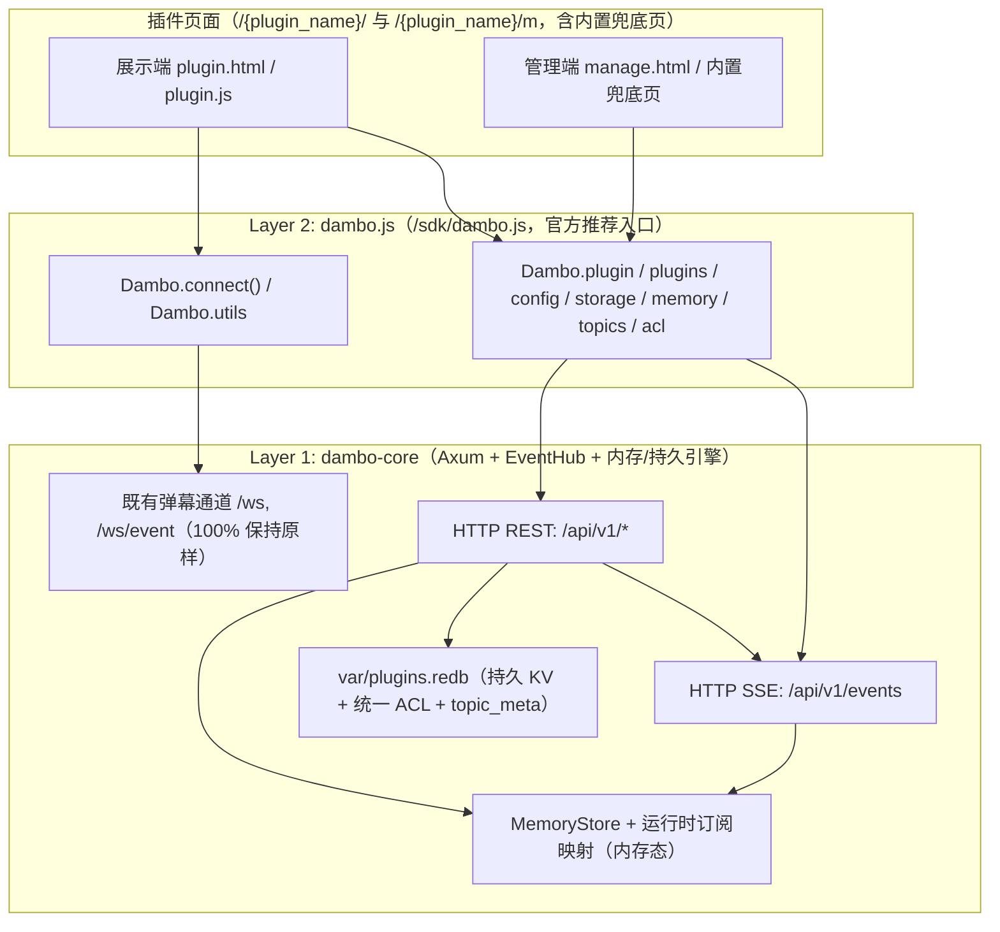
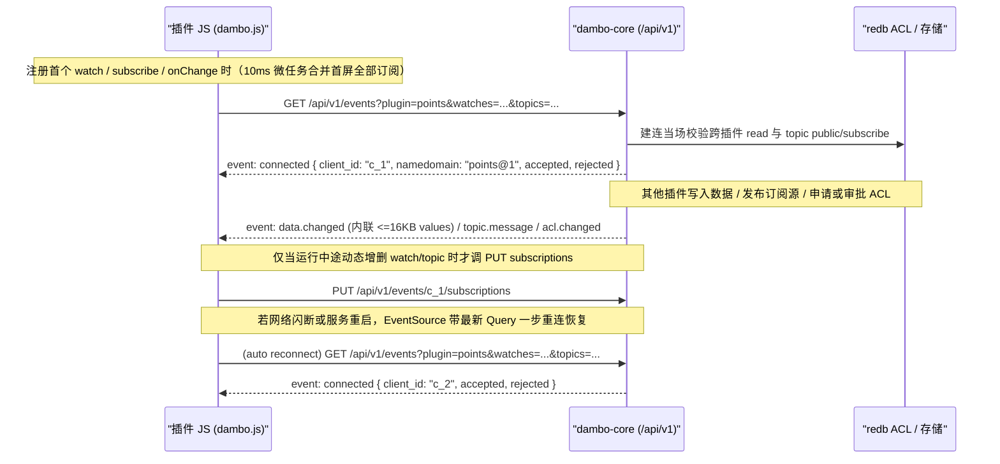

# Dambo 插件平台两层 API 与权限持久化架构设计

> 本文档为 `dambo` 插件平台扩展能力的正式设计定稿，面向后续分阶段实现提供完整规范。  
> 涵盖：**目录与路由规范**、**标识体系与自动回退查找**、**REST + SSE 两层架构**、**持久化/内存两类强类型数据**、**插件归属订阅源**、**统一 ACL 权限控制**以及**内置兜底管理页**。

---

## 1. 概述与设计原则

### 1.1 设计目标
在保留既有弹幕直播挂件能力的基础上，为 `dambo` 插件体系补全以下 4 项基础设施能力：
1. **插件间实时通讯**：支持插件声明并发布归属订阅源（支持公开免审批与私有受控订阅），结合跨插件受控内存写入监听，满足广播同步与定向联动需求。
2. **跨插件数据互操作**：允许插件按强类型模型读取或协作修改其他插件开放的数据命名空间。
3. **两类数据持久化与内存态管理**：提供基于 `redb` 的嵌入式 ACID 持久化存储与基于进程内存表的易失性存储，配合 `plugin.json` 默认配置合并。
4. **统一权限控制（ACL）**：所有跨插件的数据访问、数据变更订阅与私有事件主题订阅统一纳入持久化 ACL 管理，由目标插件自主审批与后续变更。

### 1.2 核心架构不变量
- **配置只读与运行态隔离**：`etc/config.toml` 与各插件 `plugin.json` 在运行期严格只读；运行态持久化数据库文件统一存放在 `var/` 下（默认 `var/plugins.redb`）。
- **静态页面零改写与纵深安全分层**：展示端（`/{plugin_name}/`）保持静态 HTML 原样返回、无需业务 Token；管理端（`/{plugin_name}/m`）及 ACL 审批操作叠加零侵入 HTTP 响应头防护（`X-Frame-Options`、`CSP`、真实导航签发 `HttpOnly` 管理态 Cookie 与非本机访问门禁），全局挂载同源与 `Host` 防护中间件。
- **纯 Web 零构建插件形态**：插件位于 `static/html/{plugin_name}/`，保持纯 HTML/CSS/JS，无 Node/npm 构建步骤、不暴露 `window.__TAURI__`、不在用户可控内容上使用 `.innerHTML`。
- **现有弹幕通道 100% 向后兼容**：既有 Channel A（`/ws`）、Channel B（`/ws/event`）、`Dambo.connect()` 与 `Dambo.utils` 语义保持不变。
- **官方推荐统一走 SDK（非运行时硬性拦截）**：
  - **双层边界清晰**：`/ws`、`/ws/event` 与 `/api/v1/*`（HTTP REST + SSE）同属 **Layer 1（后端原语层）**；`/sdk/dambo.js` 为 **Layer 2（前端 SDK 封装层）**。
  - 强烈推荐所有插件（包括 `plugin.html` 与 `manage.html`）100% 通过 `/sdk/dambo.js` 接入全部能力——直播间弹幕与事件流统一走 `Dambo.connect()`，平台能力统一走 `Dambo.config` / `storage` / `memory` / `topics` / `acl`，**不直接连接裸 `/ws`、`/ws/event` 或手拼 `/api/v1/*` 请求**；内置插件、内置兜底管理页及开发文档均严格遵循该规范。
  - Layer 1（`/ws`、`/ws/event`、`/api/v1/*`）仍保持为清晰稳定的公开原语，不做运行时硬性拦截，以便外部非浏览器客户端（如 Python 机器人、TTS 脚本）、调试工具及特殊高级场景直接消费。

---

## 2. 目录结构、Manifest 与 URL 路由规范

### 2.1 目录结构与文件约定
所有插件统一存放在 `static/html/{plugin_name}/` 目录下：
- **`plugin_name`**：严格等于插件目录名，仅允许 ASCII 字母、数字、`-` 与 `_`，且不得与实际占用的 3 个系统保留路由词冲突（`ws`、`api`、`sdk`；不再占用 `static`、`assets`、`health` 等额外顶层路径，健康检查统一挂在 `/api/v1/health`）。
- **合法插件唯一识别条件**：目录根下存在 `plugin.html`（**不兼容旧 `index.html`**，缺少 `plugin.html` 的目录不会被注册为插件）。

标准目录文件结构如下：

| 文件名 | 是否必需 | 用途说明 |
|---|---|---|
| `plugin.html` | **是** | 展示端入口（供 OBS 浏览器源与桌面悬浮窗使用） |
| `plugin.css` | 否 | 展示端样式表 |
| `plugin.js` | 否 | 展示端逻辑脚本 |
| `manage.html` | 否 | 自定义管理端入口；缺失时由宿主自动渲染内置兜底管理页 |
| `manage.css` | 否 | 管理端样式表 |
| `manage.js` | 否 | 管理端逻辑脚本 |
| `plugin.json` | 否 | 插件展示元信息、逻辑标识与默认配置（**不含 `permissions` 字段**） |

### 2.2 `plugin.json` 规范
`plugin.json` 中全部字段均可选；解析失败时记录 `warn` 日志并按目录默认值降级，不影响插件展示端运行。

| 字段 | 类型 | 默认值 / 回退规则 | 说明 |
|---|---|---|---|
| `plugin_id` | `string` | 回退为 `plugin_name` | 可选逻辑 ID，用于版本归并与跨版本默认查找 |
| `version` | `string \| number` | `"0"` | 可选版本号，支持整数（如 `1`）与点分版本号（如 `"1.2.0"`），未指定视为 `0` |
| `name` | `string` | 回退为旧 `title` 字段，再回退 `plugin_name` | 展示名称（兼容现有 `plugin.json` 中的 `title`） |
| `description` | `string` | `null` | 插件功能与配置说明 |
| `obs` | `object` | `null` | 可选 `{ "width": number, "height": number }`，建议画布宽高 |
| `defaults` | `object` | `{}` | 可选默认配置键值对（支持完整 Typed Entry 声明或裸值简写，详见第 5 章） |

> 明确约束：`plugin.json` 中**不包含** `permissions` 字段；所有权限关系均在运行期通过 SDK 发起申请并在目标插件管理端审批，持久化于 `var/plugins.redb`。

示例 `plugin.json`：

```json
{
  "plugin_id": "game24",
  "version": "1.2.0",
  "name": "扑克24点弹幕互动",
  "description": "A-K扑克牌24点直播互动游戏：弹幕发送算式抢答与自动计分",
  "obs": {
    "width": 560,
    "height": 420
  },
  "defaults": {
    "timeout": {
      "type": "number",
      "value": 300,
      "meta": { "min": 10, "max": 3600, "format": "integer", "label": "单局超时（秒）" }
    },
    "solvable_only": {
      "type": "bool",
      "value": false,
      "meta": { "label": "仅生成有解牌局" }
    },
    "theme": {
      "type": "enum",
      "value": "dark",
      "meta": { "options": ["light", "dark", "transparent"], "label": "界面主题" }
    },
    "banner_text": "弹幕输入算式即可抢答"
  }
}
```

### 2.3 URL 路由规范
系统保留路径优先匹配（`/sdk/`、`/ws`、`/ws/event`、`/api/`，**不新增 WebSocket 端点**），其余路径按目录与安全规则映射：

| 路由 | 匹配优先级 | 行为 |
|---|---|---|
| `GET /` | 系统 | `302` 重定向至 `/default/` |
| `GET /sdk/dambo.js` | 系统保留 | 返回内置官方 SDK 脚本 |
| `GET /ws` | 系统保留 | 既有 Channel A 弹幕 WebSocket |
| `GET /ws/event` | 系统保留 | 既有 Channel B 聚合事件 WebSocket |
| `Any /api/v1/*` | 系统保留 | Layer 1 REST + SSE 平台接口 |
| `GET /{plugin_name}` | 插件入口 | **`301` 永久重定向至 `/{plugin_name}/`**（强制补全尾斜杠并**完整透传保留原始 Query String**，确保页面相对路径与 `?timeout=300` 等查询参数不丢失） |
| `GET /{plugin_name}/` | 插件展示端 | 映射 `static/html/{plugin_name}/plugin.html` |
| `GET /{plugin_name}/m` | 插件管理端 | 映射 `static/html/{plugin_name}/manage.html`；文件缺失时返回宿主内置兜底管理页（HTTP `200`，URL 不变）。统一附加防嵌套响应头 `X-Frame-Options: DENY` 与 `Content-Security-Policy: frame-ancestors 'none'`；当来自本机（`127.0.0.1`/`::1`）且为真实文档导航（`Sec-Fetch-Dest: document`）时，通过 `Set-Cookie` 自动签发统一管理态会话 Cookie `dambo_admin`（`Path=/api/v1/; HttpOnly; SameSite=Strict`） |
| `GET /{plugin_name}/m/` | 插件管理端 | **`301` 永久重定向至 `/{plugin_name}/m`**（去除尾斜杠并**完整透传保留原始 Query String**，使自定义管理页内相对路径如 `manage.css`、`./asset.png` 直接复用同目录） |
| `GET /{plugin_name}/{*path}` | 插件资源 | 映射 `static/html/{plugin_name}/{path}`（保留路径规范化与目录穿越拦截；`m` 由精确路由优先接管） |

---

## 3. 标识体系、三级查找与轻量身份

### 3.1 标识定义与 `namedomain`（采用按主版本号归并的 A 方案）
平台中仅存在两个插件标识概念：
- **`plugin_name`**：目录名，本地路由与静态资源唯一标识。
- **`plugin_id`**：`plugin.json` 中声明的逻辑标识；未指定时默认等于 `plugin_name`。

两者与主版本号（`major_version`）共同构成存储和权限系统的核心归属域：
- **归属域（`namedomain`）**：由 **`(plugin_id, major_version)`** 组合构成（文本表示 `{plugin_id}@{major}`，例如 `0.x` 为 `id@0`，`1.2.0` 与 `1.2.1` 均为 `id@1`，`2.0.0` 为 `id@2`；未指定 `version` 时为 `{plugin_id}@0`）。
- **设计效果**：
  - 同一大版本内的 bug 修复与小版本升级（如 `1.2.0` → `1.2.1`），以及保持同 `plugin_id` 与大版本号的目录迁移（如 `points` → `points_prod`），均自动无缝延续历史持久化数据与已审批 ACL 规则；
  - 跨大版本破坏性升级（`1.x` → `2.0.0`）后生成独立的 `namedomain`（`id@2`），旧版本数据与新版本数据天然隔离，避免数据结构变更污染旧版数据。

### 3.2 版本号归一化、比较规则与标识符字符集
- **版本号归一化与规范串**：
  - `version` 支持 JSON 字符串或整数；缺省、空串或非合法数字格式时归一化为 `"0"`（非法格式记录 `warn` 日志）。
  - 剥离可选前导 `v` / `V`，按 `.` 切分为非负整数段，**去掉末尾多余 `.0` 段**得到唯一规范完整版本串（例如 `0` / `"0.0.0"` → `"0"`，`1` / `"1.0.0"` → `"1"`，`"v1.2.0"` → `"1.2"`，`"1.2.3"` → `"1.2.3"`）；其首段即为 `major_version`。
  - 比较高低时按整数段逐段对比，缺失尾段补 `0`（例如 `"1.10.2"` > `"1.2.1"` > `"1.2"` > `"1"` == `"1.0.0"` > `"0"`）。
- **严格标识符字符集**（防止路由段、分隔符 `@` / `:` 与路径穿越歧义）：
  - `plugin_name` 与 `plugin_id`：仅允许 `[A-Za-z0-9_-]`，非空且 `≤ 64` 字节（禁止 `@`、`/`、`:`、`*`）；
  - `namespace` 与订阅源 `topic` 名称：仅允许 `[A-Za-z0-9_.-]`，非空且 `1..=128` 字节（禁止 `:`、`*`、`/` 等分隔符）；
  - `key`：非空且 UTF-8 长度 `1..=128` 字节，禁止控制字符、空字节与 `/`。

### 3.3 目标插件与归属域解析规则（前置快路径 + 三级自动 Fallback）
当操作（数据读写/订阅、话题查询/订阅、ACL 申请）传入目标参数 `target`（或路径中的 `{owner}`）时，后端按以下前置快路径与三级规则**自动确定唯一目标插件与 `namedomain`**，不引入运行态占用锁，也不因重复 `plugin_id` 或同版本共存返回 `409` 报错：

- **前置快路径 1（本插件自身直达，防止被高版本同 `plugin_id` 目录劫持）**
  - 若 `target == "@self"`，或 `target` 等于当前请求头 `X-Dambo-Plugin` 声明的调用方 `plugin_name`，**直接定位到调用方自身实例及其 `namedomain`**，绝不走跨插件三级查找（确保旧版目录访问自身数据时不会被同 `plugin_id` 的高版本目录劫持）。
- **前置快路径 2（`namedomain` 直达，支持拿 SSE 事件 `ev.owner` 直接回查）**
  - 若 `target` 包含 `@`（形如 `{plugin_id}@{major}`），**直接按 `namedomain == target` 匹配**（若对应多个同大版本目录，按完整 `version` 最高及 `plugin_name` 字典序选取活跃实例元信息；未命中返回 `404 PLUGIN_NOT_FOUND`）。
- **常规跨插件三级自动 Fallback 查找**：
  1. **第一级：`plugin_id` 匹配**
     - 在已发现插件中查找 `effective_plugin_id == target` 的集合；
     - 若命中 **1 个**：直接确定；
     - 若命中 **0 个**：回退到按 **`plugin_name == target`** 精确匹配（仍未命中则返回 `404 PLUGIN_NOT_FOUND`）；
     - 若命中 **≥ 2 个**：进入第二级。
  2. **第二级：完整 `version` 最高优选**
     - 按第 3.2 节的完整数值版本号规则选取集合中 `version` 最高的候选（同一大版本内优先命中最新小版本，如 `1.2.1` > `1.2`）；
     - 若最高版本仅有 **1 个**：直接确定；
     - 若最高版本仍并列（含全部未设定 `version` 即同为 `"0"`）：进入第三级。
  3. **第三级：`plugin_name` 自动兜底**
     - 若并列候选中存在 `plugin_name == target` 的目录，优先选中它；
     - 否则按 `plugin_name` 字典序升序自动选取首个插件（并在 `PluginRegistry` 扫描阶段打 `warn` 日志提醒存在重复 `plugin_id` 与相同版本）。

### 3.4 轻量身份声明与管理态分层校验
- 静态 HTML（`plugin.html`、`manage.html` 及内置兜底管理页）均原样返回，**不做运行时 HTML 内容改写与内联 Token 注入**。
- 展示端与常规 API 调用采用声明式传递：
  - **HTTP REST 请求**：通过请求头 `X-Dambo-Plugin: {plugin_name}` 声明（`dambo.js` 默认从 `location.pathname` 第一段自动解析并注入）；
  - **SSE 实时连接**：通过 `GET /api/v1/events?plugin={plugin_name}&mode=view|manage` 传递（因浏览器原生 `EventSource` 不支持自定义 HTTP 请求头）。
- 服务端校验 `{plugin_name}` 必须在当前 `PluginRegistry` 中存在，并将其解析为规范的 `namedomain` 后再执行数据归属定位与 ACL 检查。
- **管理态补充校验**：对管理页 `/{plugin_name}/m` 及 ACL 审批/修改/撤销/拒绝接口，额外启用 HTTP 管理态 `HttpOnly` 会话 Cookie、`Referer`、同源/`Host` 及非本机访问门禁校验（详见第 6.3 节）。该机制作为同源协作、外部跨站拦截与远程局域网防护，不承担同源恶意 JS 沙箱隔离职责。

---

## 4. 总体分层架构与通讯通道

### 4.1 总体分层架构图



### 4.2 关键架构取舍说明
1. **统一收口为 REST + SSE（无 `/ws/plugin`）**：
   - 不新增插件 WebSocket 端点；所有命令式请求（数据读写、创建/发布订阅源、ACL 申请与审批、订阅集同步）走标准 HTTP REST；所有实时推送（数据变更 `data.changed`、订阅源消息 `topic.message`、ACL 通知 `acl.*`）走单一 `EventSource`（`GET /api/v1/events`）。
   - 该设计保持现有 `/ws` 与 `/ws/event` 纯净，同时免除 WebSocket 帧配对与管理页空连弹幕流的开销。
2. **不设独立 P2P 通道（及内联变更值消除竞态）**：
   - 跨插件状态共享由 `persist` / `memory` + `watch` 承担；
   - 跨插件定向动作触发（例如“游戏结束后触发音效插件播放”）由接收方开放特定内存命名空间（如 `memory:cmd`）的 `write` ACL 并 `watch`，发送方写入即实时触发——天然复用同一套 ACL 审批与管理页可见性；
   - **内联值消除二次拉取竞态**：当单次写入/批量写入的变更条目序列化总大小 `≤ 16 KB` 时，`data.changed` 事件直接内联携带最新 `"values": { "key": <value> }`，订阅方无需二次发起 HTTP `GET` 即可直接从事件帧消费当次写入值，既省去 N+1 回查请求，也消除了高频覆写同一指令键时的二次拉取丢值竞态；对于一对多广播或超大载荷事件流则使用插件归属 `topics`。

---

## 5. 两类强类型数据与存储设计

### 5.1 两类对称存储与精简 KV 语义
平台提供两类语义完全对称的键值对存储，均归属在 `namedomain = (plugin_id, major_version)` 之下，组织为 `(owner_namedomain, namespace, key)`：

| 存储类别 | API 前缀 / SDK 模块 | 物理载体与生命周期 | 典型用途 |
|---|---|---|---|
| **持久化数据（`persist`）** | `/api/v1/data/persist/...`<br>`Dambo.storage` / `Dambo.config` | `var/plugins.redb`，服务重启永久保留 | 插件设置（`config`）、观众积分、历史记录、持久状态 |
| **内存数据（`memory`）** | `/api/v1/data/memory/...`<br>`Dambo.memory` | `dambo-core` 并发内存表，进程重启自动清空 | 本场直播计分、游戏实时状态、定向动作指令槽（`cmd`） |

两类数据共同提供**精简 KV 操作集**：
- 单键：`get(ns, key)`、`getEntry(ns, key)`、`set(ns, key, value, schema?)`（可选第 4 参数显式定义 `{ type, meta }`）、`delete(ns, key)`
- 集合与批量：`namespaces()`、`list(ns, { prefix, keys, limit, withSchema })`（兼顾前缀列举与指定多键读取，默认返回 `{ key: value }`，传 `withSchema: true` 返回完整信封字典）、`mset(ns, map)`、`clearNamespace(ns)`
- 实时监听：`watch(ns, cb, { prefix })`（数据提交成功后实时触发 `data.changed`）
- **明确不引入的特性**：不拆出独立的 `define` / `mdefine` / `mget` 方法名，不做 `version` / CAS 乐观锁、原子 `incr` 与键级 TTL 过期。

### 5.2 默认配置（`plugin.json` `defaults`）与 `persist("config")` 协作
- **只读基准 + 读时合并**：`plugin.json` 中的 `defaults` 仅作只读基准定义，**不在启动或扫描阶段预写入 `var/plugins.redb`**，从而确保更新插件文件时新增默认配置项立即生效且不污染持久层。
- **一致的合并读取与热更新冲突降级**：
  - 修改配置项实际写入 `persist` 下的保留命名空间 `"config"`（即 `(namedomain, "config", key)`）；
  - `persist/config` 下的 `get` 与 `list`（含指定 `keys`）均严格执行一致的 **`defaults` 为基、持久化 `"config"` 覆盖** 读时合并；
  - 若插件更新 `plugin.json` 收紧或改变了某 `defaults` 键的类型/约束（例如调小 `max` 或更改 `enum` 可选项），导致 `redb` 中残留的历史覆盖值不再合规，读时合并将**自动忽略该脏覆盖值、记录 `warn` 日志并回退返回最新 `defaults` 默认值**，避免前端崩坏；
  - 删除 `"config"` 中的覆盖键即可恢复单项默认；清空整个 `"config"` 命名空间（`clearNamespace("config")`）等价恢复全部默认值。

### 5.3 强类型系统与 JSON 兼容性
为兼顾强约束数据互操作与兜底管理页自动化表单渲染，每条记录支持 **6 种正交基础类型**及可选展示/校验提示 `meta.format`，**100% 兼容标准 JSON（RFC 8259）**：

| `type` | JSON 原生对应 | 可选/必需 `meta` 字段 | `meta.format` 扩展 | 兜底管理页控件 |
|---|---|---|---|---|
| `number` | Number | `min`、`max`、`step`、`label`、`description` | `integer`（校验整数）、`slider`（滑块） | 数字框 / 滑块 |
| `string` | String | `max_length`、`placeholder`、`label`、`description` | `color`（色值）、`textarea`（多行）、`url` | 输入框 / 调色盘 / 多行框 |
| `bool` | Boolean | `label`、`description` | — | 开关 Toggle |
| `enum` | String | **必需** `options`（`string[]` 或 `[{ value, label }]`）；`label`、`description` | — | 下拉框 `<select>` |
| `list` | Array | `item`（嵌套 6 种类型之一的定义）、`max_items`、`label`、`description` | — | 增删项列表 / 多选框（`item` 为 `enum` 时） |
| `struct` | Object | `fields`（按字段名递归嵌套 6 种类型定义，含 `optional`/`nullable` 标记；缺省时允许自由 JSON 对象）、`label`、`description` | — | 分组子表单 / JSON 对象编辑器 |

**`null` 值与兼容性边界**：
- **顶层键禁用 `null`**：顶层写入 `null` 返回 `400 INVALID_DATA_TYPE`；“清除/置空”统一使用 `DELETE` 删除键，避免 `null` 与“键不存在”混义。
- **内部字段可为空**：未声明 `fields` 的自由 `struct`、`meta.fields` 中标记为 `optional: true` 或 `nullable: true` 的字段、以及标记 `nullable: true` 的 `list` 元素均允许包含 JSON `null`，确保存储原始事件/用户对象时零阻抗兼容。

### 5.4 自描述存储信封、推断与 Schema 保护
所有数据条目在传输与存储层面采用统一的 Typed Entry 信封：

```json
{
  "type": "enum",
  "value": "dark",
  "meta": {
    "options": ["light", "dark", "transparent"],
    "label": "主题模式",
    "description": "控制挂件背景透明度与文字配色"
  }
}
```

校验、模式判定与 Schema 保护规则如下：
1. **后端写值与定义 Schema 唯一判定准则**：
   - 在 `PUT .../keys/{key}`（及 `POST .../mset`）中，**条目 JSON 对象仅包含 `value` 字段（不含 `type` 与 `meta`）时判定为普通写值模式**；**包含 `type` 或 `meta` 字段（对应 SDK `set(ns, key, val, schema)`）时判定为显式 Schema 定义模式**。
2. **显式定义 Schema 模式**：严格校验 `value` 是否符合 `type` 及 `meta` 约束（如 `min`/`max`、`integer`、`options`、`max_items`、`fields`）。
3. **普通写值模式**：
   - 若目标键在当前存储或 `plugin.json` `defaults["config"]` 中**已有定义**：自动沿用既有 `type` 与 `meta` 执行强校验，仅更新 `value`；
   - 若为**全新键**：自动推断 JSON 原生对应类型（`number` / `string` / `bool` / `list` / `struct`；其中 `enum` 必须传入 `schema: { type: "enum", meta: { options: [...] } }` 显式定义）。
4. **Schema 所有权与 `defaults` 锁定保护**：
   - 仅数据所属插件自身（`caller_namedomain == owner_namedomain`）可携带 `type` / `meta` 定义或变更键的 Schema；外部插件即使获得 ACL `write` 权限也只能更新 `value`，若携带 `type` 或 `meta` 尝试修改对方 Schema 则返回 `403 SCHEMA_LOCKED`；
   - 在 `persist/config` 命名空间下，凡已在 `plugin.json` `defaults` 中声明的键，其 `type` 与 `meta` 由 `defaults` 锁定，运行时即便本插件自身也禁止篡改其 Schema（返回 `403 SCHEMA_LOCKED`），仅允许更新符合约束的 `value`。

### 5.5 持久层 `var/plugins.redb` 三表结构与容量上限
- **配置项扩展建议**：在 `dambo-core/src/config.rs` 的 `ServerConfig` 中新增 `plugin_db_file: String`，默认 `"var/plugins.redb"`，遵循与 `state_file`（`"var/state.json"`）一致的配置风格。
- **`redb` 三表定义**（将权限规则与申请状态合为单表 `acl_records`，消除双表同步并天然支持“保持现有 `read` 权限不断流的同时申请升级 `write`”）：

| Table 名称 | Key 类型 | Value（UTF-8 JSON） | 说明 |
|---|---|---|---|
| `kv_data` | `(&str, &str, &str)`<br>`(owner_namedomain, namespace, key)` | `{ type, value, meta? }` | 持久化 Typed KV 数据 |
| `acl_records` | `(&str, &str, &str)`<br>`(owner_namedomain, requester_namedomain, resource)` | `{ level, status, requested_level?, reason?, note?, updated_at }` | 统一 ACL 记录（`level`: 当前生效等级 `"none"\|"read"\|"write"\|"subscribe"`；`status`: `"pending"\|"granted"\|"denied"`） |
| `topic_meta` | `(&str, &str)`<br>`(owner_namedomain, topic_name)` | `{ public, description?, updated_at }` | 插件归属订阅源元信息与可见性，防止 OBS 冷启动竞态 |

- **容量、字符集与并发工程约束（同时保护 `persist` 与 `memory`）**：
  - 字符集：`namespace` 与 `topic` 遵循 `[A-Za-z0-9_.-]`（`1..=128B`，禁止 `*`、`:`、`/`）；`key` 非空且 `1..=128B`（禁止控制字符、空字节与 `/`）；
  - 单条记录序列化 JSON 体积：`≤ 256 KB`；
  - 单个 `namedomain` 在单类存储下总键数 `≤ 10,000`、总数据体量 `≤ 16 MB`（超限返回 `413 QUOTA_EXCEEDED`）；
  - **配额 `O(1)` 增量计数**：`dambo-core` 启动打开 `var/plugins.redb` 时做一次初始化扫描汇总，运行期在内存中维护 `HashMap<Namedomain, QuotaStats { keys, bytes }>`，每次写入/覆盖/删除按新旧字节差做 **`O(1)` 增量更新**，避免每次写事务做磁盘范围扫描；
  - **并发实现约束**：`redb` 写事务为同步文件 I/O，在 Axum async handler 中需统一经 `tokio::task::spawn_blocking` 调度执行，防止阻塞 Tokio worker 影响 `/ws` 弹幕转发延迟。

---

## 6. 插件归属订阅源、统一 ACL 与安全防护

### 6.1 插件归属订阅源（`topics`）
- **归属与持久化声明**：订阅源归属于发布插件的 `namedomain`，元信息持久化保存在 `var/plugins.redb` 的 `topic_meta` 表中，由发布方通过 `PUT /api/v1/topics/{name}` 预声明或在 `POST /api/v1/topics/{name}` 发布时顺带自动声明（操作身份由 `X-Dambo-Plugin` 确定，仅能操作本插件自身订阅源）；查询任意插件已注册的订阅源统一通过 `GET /api/v1/plugins/{target}` 的 `topics` 字段返回。
- **冷启动竞态消除**：由于 `topic_meta` 持久化落盘，即使在 OBS 多浏览器源并发启动时订阅方比发布方先打开 200ms，只要发布方此前曾声明过 `public: true`，服务端即可立即放行订阅请求；同时即便展示端未打开，管理页 `/{plugin_name}/m` 也能直接读取并切换可见性。
- **公开与私有可见性**：
  - 创建或首次发布时可指定 `public: bool`（**默认为 `false` 私有**）：
    - **`public: true`（公开订阅源）**：其他插件**无需申请 ACL 批准即可直接订阅**；
    - **`public: false`（私有订阅源）**：其他插件必须在发布方 ACL 中具备有效授权方可订阅。
  - 若运行期将某订阅源从 `public: true` 切换为 `public: false`，服务端立即检查并切断不再具备 `topic:<name>` / `topic:*` 权限的外部 SSE 订阅，并推送通知。

### 6.2 统一 ACL 权限矩阵（单表 `acl_records` 模型）
所有需要跨插件授权的资源均纳入同一张持久化表 `acl_records`（存 `var/plugins.redb`），**仅目标插件本身**可在自己的管理端 `/{plugin_name}/m` 批准、修改或撤销对自身资源的授权（宿主不提供集中式审批界面）：

| 访问范围 | `resource` 格式 | 允许的生效 `level` | 默认策略与语义说明 |
|---|---|---|---|
| 本插件自身数据与订阅源 | — | 隐式最高权限 | 始终放行，无需 ACL 记录 |
| 跨插件系统配置（保留命名空间） | `persist:config` | `none` \| `read` | **跨插件写保护**：仅本插件自身可写/重置；外部插件即使获授 `persist:*` 的 `write` 通配权限，对 `persist:config` 也最多仅具有 `read`（含 `watch`）权限 |
| 跨插件持久化业务数据与 `watch` | `persist:<namespace>` 或 `persist:*` | `none` \| `read` \| `write` | 默认拒绝（`none`）；`read` 包含 `watch` 订阅，`write` 隐含 `read`（不含 `persist:config` 的写权限） |
| 跨插件内存数据与 `watch` | `memory:<namespace>` 或 `memory:*` | `none` \| `read` \| `write` | 默认拒绝（`none`）；`read` 包含 `watch` 订阅，`write` 隐含 `read` |
| 跨插件私有订阅源 | `topic:<name>` 或 `topic:*` | `none` \| `subscribe` | 订阅源为 `public: true` 时直接放行；否则默认拒绝（`none`），需获 `subscribe` |

**匹配优先级、平滑升级与实时联动**：
1. 规则匹配时，**精确资源名（如 `persist:scores`）严格优先于通配规则（`persist:*`）**；仅当精确规则不存在时回退匹配通配规则。
2. **单表支持不断流申请升级**：初次申请时写入 `{ level: "none", status: "pending", requested_level: "..." }`；若插件当前已拥有 `level: "read"`，后续发起升级 `write` 申请时，**保持现行 `level: "read"` 不变**（线上读取与 `watch` 不断流），仅更新 `status: "pending", requested_level: "write"`。
3. **审批、拒绝与删除收口**：
   - `PUT /api/v1/acl/grants/{requester}` 传入有效等级（`read`/`write`/`subscribe`）即批准/修改权限（置 `level = <new>, status = "granted"`）；传入 `level: "none"` 即拒绝申请或关闭权限（置 `level = "none", status = "denied"`）；
   - `DELETE /api/v1/acl/grants/{requester}?resource=...` 彻底删除该条 `acl_records` 记录；
   - 被拒绝（`denied`）后允许重新发起申请置回 `pending`（服务端设 5 秒轻量冷却防恶意循环刷屏）。
4. 每次申请、批准、修改、拒绝或删除后，服务端立即清理受影响 SSE 连接中已丧失权限的跨插件 `watches` 与私有 `topics` 订阅，并向双方在线 SSE 连接推送统一的 **`acl.changed`** 事件。

### 6.3 管理端与全局最小安全闭环
管理界面（`/{plugin_name}/m`）集中了 ACL 审批/撤销、配置修改、命名空间清空与订阅源公开开关等高危操作。为在不引入前端构建或破坏展示端轻量声明的前提下防范局域网越权、跨站 CSRF、DNS Rebinding、XSS 与点击劫持，`dambo-core` 后端统一落实以下 **3 条最小安全规则**：

1. **全局同源与 `Host` 防护中间件（防外部网页 CSRF 与 DNS Rebinding）**
   - **禁止跨域与强制自定义头预检**：所有 `/api/v1/*` 响应**不返回任何 `Access-Control-Allow-*` 头**；全部写接口（`POST`/`PUT`/`DELETE`）强制要求携带 `X-Dambo-Plugin` 请求头（`/api/v1/auth/manage` 除外），浏览器遇到跨站自定义头会触发 CORS preflight 预检并直接拦截；
   - **来源头（Origin / Fetch Metadata）校验**：写请求若携带 `Origin` 或 `Sec-Fetch-Site` 请求头，必须符合同源要求（`Sec-Fetch-Site` 为 `same-origin` 或 `none`，且 `Origin` 与当前合法 `Host` 同源），否则返回 `403 FORBIDDEN_ORIGIN`；
   - **`Host` 白名单校验**：当服务端监听回环地址（`127.0.0.1`/`localhost`/`::1`）时，仅允许回环 `Host`；当监听非回环地址（如 `0.0.0.0`）时，允许回环地址、本机网卡实际 IP 及 `etc/config.toml` 中可选配置的 `[server].allowed_hosts` 白名单（例如局域网/Tailscale 域名），非法 `Host` 返回 `403 FORBIDDEN_ORIGIN`，彻底阻断 DNS Rebinding。

2. **管理端 `/m` 专属安全头、XSS 防护与单一 `dambo_admin` 管理态 Cookie（防点击劫持与跨插件后台自批）**
   - **防点击劫持（Clickjacking）**：`GET /{plugin_name}/m` 响应头统一附加 `X-Frame-Options: DENY` 与 `Content-Security-Policy: frame-ancestors 'none'`，禁止被任何页面通过 `iframe` 套壳嵌套；
   - **防申请理由 XSS**：内置兜底管理页渲染来自外部插件的 `reason`、`note`、以及任意 `key`/`value`/`name`/`description` 时**严格禁止 `.innerHTML`，一律使用 `textContent` 或安全的 DOM API**；
   - **单一 `dambo_admin` 管理态 `HttpOnly` 会话 Cookie（本机与远程二合一）**：
     - 本机（`127.0.0.1` / `::1`）通过真实浏览器文档导航（`Sec-Fetch-Dest: document`）访问任意 `GET /{plugin_name}/m` 时，或非本机通过 `POST /api/v1/auth/manage` 完成 `admin_token` 口令校验时，服务端统一通过 `Set-Cookie` 签发唯一的进程级签名管理 Cookie：`dambo_admin=<signed_token>; Path=/api/v1/; HttpOnly; SameSite=Strict`（服务重启密钥轮转即自动失效；`Path=/api/v1/` 使浏览器调用 `/api/v1/acl/*` 时自动携带，且不在浏览器内堆积多个按插件拆分的 Cookie）；
     - 第三方插件 JS 在展示页中通过后台 `fetch('/other_plugin/m')` 无法由浏览器伪造 `Sec-Fetch-Dest: document`，且 Cookie 带有 `HttpOnly` 无法被 JS 读取；
     - **管理态专属接口强制校验**：`PUT /api/v1/acl/grants/{requester}` 与 `DELETE /api/v1/acl/grants/{requester}` 必须验证请求同时携带有效的 `dambo_admin` 会话 Cookie 且 `Referer`（若浏览器提供）指向同源 `/{X-Dambo-Plugin}/m`，缺失或失效返回 `401 UNAUTHORIZED`；
   - **诚实的安全边界说明**：该机制有效阻断外部网页跨站请求、未授权局域网设备访问、普通展示端误调用以及在用户从未打开过 `/m` 管理页时第三方插件后台悄悄发起的自我审批。但若主播在同一浏览器中已打开过管理页（浏览器已持有 `dambo_admin` Cookie），由于所有插件共享同一 HTTP Origin，浏览器层面无法阻止同源恶意脚本借用已持有的同源 Cookie（彻底对抗同源恶意 JS 需为每个插件分配独立子域 Origin，超出轻量架构范围）。

3. **非本机（`0.0.0.0` 局域网）访问 `/m` 的 Loopback-First 门禁**
   - **本机免密**：来自回环地址（`127.0.0.1` / `::1`）访问 `/{plugin_name}/m` 及管理接口直接自动签发/放行 `dambo_admin`，保持本地开发与桌面端零摩擦体验；
   - **远程局域网门禁开关**：在 `etc/config.toml` 的 `[server]` 下新增可选配置：
     - `allow_remote_manage: bool`（默认 `false`）：控制是否允许非本机 IP 访问管理页与管理接口；
     - `admin_token: Option<String>`（可选，默认 `None`）：配置后，非本机设备需通过 `POST /api/v1/auth/manage` 验证口令以获取 `dambo_admin` Cookie；若 `allow_remote_manage = false` 且未配置 `admin_token`，非本机访问 `/{plugin_name}/m` 与管理态接口直接返回 `403 FORBIDDEN_ORIGIN`；
     - `allowed_hosts: Vec<String>`（可选，默认空）：监听 `0.0.0.0` 时允许额外接受的 `Host` 域名列表。
   - **不影响双机推流展示端**：独立推流机/平板通过局域网访问展示端 `/{plugin_name}/`（含 `/api/v1/plugins`、`/api/v1/data/*`、`/api/v1/topics/*`、`/api/v1/events` 及发起 `POST /api/v1/acl/requests`）不受 `allow_remote_manage` 限制。

---

## 7. Layer 1 后端原语详细契约（`/api/v1/*`）

### 7.1 公共请求约定与统一错误信封
- 调用方插件目录名通过请求头 `X-Dambo-Plugin: {plugin_name}` 传入（部分公开读取端点如 `GET /api/v1/plugins` 可不传，未传且端点需要调用方身份时返回 `400 INVALID_ARGUMENT`）。
- 所有 `2xx` 均返回 `application/json`（SSE `/api/v1/events` 为 `text/event-stream` 除外）。
- 所有非 `2xx` 返回统一 JSON 错误信封：

```json
{
  "error": {
    "code": "ACL_DENIED",
    "message": "Permission 'read' required on persist:scores for target game24@1",
    "details": {
      "target_namedomain": "game24@1",
      "resource": "persist:scores",
      "required_level": "read"
    }
  }
}
```

| HTTP 状态码 | 错误码 `code` | 触发场景 |
|---|---|---|
| `400` | `INVALID_ARGUMENT` | 缺失 `X-Dambo-Plugin`、非法 `namespace`/`key`/`topic`、参数解析失败 |
| `400` | `INVALID_DATA_TYPE` | 顶层写入 `null` 或非 6 种支持类型的值 |
| `400` | `TYPE_MISMATCH` | 值类型与既有/声明 `type` 不符 |
| `400` | `INVALID_ENUM_VALUE` | `enum` 缺失 `options` 或值不在 `options` 列表内 |
| `400` | `OUT_OF_RANGE` | `number`/`string`/`list` 超出 `min`、`max`、`max_length`、`max_items` 或非 `integer` |
| `400` | `STRUCT_FIELD_INVALID` | `struct` 缺少必填 `fields` 成员或子字段类型校验失败 |
| `401` | `UNAUTHORIZED` | 调用管理态接口缺失/失效 `dambo_admin` 会话 Cookie，或远程访问 `/m` 尚未通过 `admin_token` 认证 |
| `403` | `ACL_DENIED` | 跨插件读写数据、`watch` 或订阅私有 `topic` 权限不足；或非 `owner` 尝试审批 ACL |
| `403` | `SCHEMA_LOCKED` | 跨插件写请求尝试修改既有键的 `type` 或 `meta` |
| `403` | `FORBIDDEN_ORIGIN` | 非法 `Host`（DNS Rebinding 拦截）、跨站 `Origin`/`Sec-Fetch-Site`、或未开启远程管理时非本机访问 `/m` |
| `404` | `PLUGIN_NOT_FOUND` | 调用方或目标插件在 `PluginRegistry` 中不存在 |
| `404` | `KEY_NOT_FOUND` | 请求的存储键不存在（SDK `get()` 仅对此码返回 `undefined`） |
| `404` | `CLIENT_NOT_FOUND` | 请求的 SSE `client_id` 不存在或已断开 |
| `413` | `QUOTA_EXCEEDED` | 单值超过 `256 KB` 或单 `namedomain` 存储超出键数/总容量上限 |
| `429` | `TOO_MANY_REQUESTS` | 短时间重复发送被拒绝的 ACL 申请触发冷却限制 |

### 7.2 REST 接口清单（共 15 个精简端点）

#### (1) 插件发现、元信息与首屏配置/订阅源合并下发
- **`GET /api/v1/plugins`**  
  返回全部已发现插件列表及各插件已注册的 `topics` 摘要。
- **`GET /api/v1/plugins/{target}`**  
  按第 3.3 节规则（支持 `@self`、`namedomain` 或三级查找）定位目标插件，返回完整元信息、已声明的 `topics` 列表，以及（当调用方为本插件自身或具备 `persist:config` `read` 权限时）读时合并后的 `config` 快照（含 `is_overridden` 标记），使前端首屏初始化 `Dambo.plugin.meta()`、`Dambo.config.get()`、`Dambo.config.schema()` 与 `Dambo.topics.list()` 共享 **1 次 HTTP 请求**：
  ```json
  {
    "plugin_name": "game24",
    "plugin_id": "game24",
    "version": "1.2",
    "namedomain": "game24@1",
    "name": "扑克24点弹幕互动",
    "description": "...",
    "route": "/game24/",
    "manage_route": "/game24/m",
    "has_custom_manage": false,
    "obs": { "width": 560, "height": 420 },
    "defaults": { "...": { "type": "...", "value": "..." } },
    "config": {
      "timeout": { "type": "number", "value": 180, "meta": { "min": 10, "max": 3600 }, "is_overridden": true }
    },
    "topics": [
      { "name": "round", "public": true, "description": "牌局状态播报" }
    ]
  }
  ```

#### (2) 两类强类型数据（`{store}` ∈ `persist` \| `memory`）
路径采用显式 `/ns/{ns}/keys/{key}` 分层结构，杜绝命名空间/键名与保留后缀冲突。`{owner}` 支持传入 `@self`、`namedomain`、`plugin_id` 或 `plugin_name`：
- **`GET /api/v1/data/{store}/{owner}/namespaces`**  
  列举命名空间（本插件或拥有 `*` `read` 权限时返回当前全部非空命名空间，且 `persist` 下若 `defaults` 非空则始终包含 `config`；仅拥有部分精确命名空间权限时返回已授权且非空的命名空间交集）。
- **`GET /api/v1/data/{store}/{owner}/ns/{ns}?prefix=...&keys=k1,k2&limit=...`**  
  按前缀或指定 `keys`（逗号分隔）列举条目字典 `{ "entries": { "k1": { "type": "...", "value": ..., "meta?": ... } } }`（同时覆盖前缀扫描与多键批量读取，无需单独的 `POST .../mget` 端点）。
- **`DELETE /api/v1/data/{store}/{owner}/ns/{ns}`**  
  清空整个命名空间（需要自身或 `write` 权限，其中 `persist/config` 仅限本插件自身可调），触发 `data.changed`。
- **`GET /api/v1/data/{store}/{owner}/ns/{ns}/keys/{key}`**  
  读取单条完整信封 `{ key, type, value, meta? }`（`persist/config` 自动与 `defaults` 读时合并，不再合法的旧覆盖值回退默认）。
- **`PUT /api/v1/data/{store}/{owner}/ns/{ns}/keys/{key}`**  
  写入或定义单键。Body 仅含 `{ "value": <json> }` 时为写值模式；含 `type` 或 `meta` 时为显式 Schema 定义模式（仅本插件自身且非 `defaults` 锁定键可调）；提交后触发 `data.changed`。
- **`DELETE /api/v1/data/{store}/{owner}/ns/{ns}/keys/{key}`**  
  删除单键（`persist/config` 场景下仅限本插件自身可调，删除即恢复 `defaults` 对应默认值），触发 `data.changed`。
- **`POST /api/v1/data/{store}/{owner}/ns/{ns}/mset`**  
  Body: `{ "entries": { "k1": { "value": 1 }, "k2": { "type": "bool", "value": true } } }`；`persist` 下在单次 `redb` 写事务内原子提交並推送单批 `data.changed`。

#### (3) 插件归属订阅源（`topics`）
查询任意插件的订阅源已由 `GET /api/v1/plugins/{target}` 的 `topics` 字段统一提供；写接口仅操作当前调用方插件自身（由 `X-Dambo-Plugin` 确定归属 `namedomain`），路径极简且无 Axum 参数冲突：
- **`PUT /api/v1/topics/{name}`**  
  预声明或更新本插件归属订阅源的可见性与描述。Body: `{ "public": true|false, "description?": "..." }`（`public` 缺省为 `false`）。若由 `public: true` 切为 `false`，服务端立即裁剪不合规的跨插件 SSE 订阅。
- **`DELETE /api/v1/topics/{name}`**  
  注销本插件归属订阅源并清理对应 SSE 订阅。
- **`POST /api/v1/topics/{name}`**  
  向本插件归属订阅源发布事件（发布即自动注册：若该订阅源尚未存在，按可选传入的 `"public": true|false` 与 `"description"` 自动写入 `topic_meta`）。Body: `{ "payload": <json>, "public?": bool, "description?": "..." }`。返回 `{ "delivered": <number> }`。

#### (4) 统一 ACL 权限管理（基于单表 `acl_records` 的 4 个端点）
- **`GET /api/v1/acl`**  
  一次性返回当前插件 `namedomain` 视角的 `{ "incoming": [...], "outgoing": [...] }`：
  - `incoming`：`owner == caller` 的全部记录（同时包含 `status: "pending"` 待审批项与 `status: "granted"` 已授权规则，每项附带后端动态拼装的 `requester_display: { plugin_name?, name?, installed }`，管理页 1 次请求即可渲染完整权限面板）；
  - `outgoing`：`requester == caller` 的全部对外申请与当前生效 `level`。
- **`POST /api/v1/acl/requests`**  
  当前插件向目标插件发起或升级权限申请。Body: `{ "target": "...", "resource": "persist:scores", "level": "read", "reason?": "..." }`；写入 `acl_records`（若原本已拥有较低权限如 `read` 则保持 `level: "read"` 不断流，仅置 `status: "pending", requested_level: "write"`；被拒后重新申请需间隔 5 秒冷却，否则返回 `429 TOO_MANY_REQUESTS`），并向双方推送 `acl.changed`。
- **`PUT /api/v1/acl/grants/{requester_namedomain}`**  
  **（管理态专属接口，需携带 `dambo_admin` `HttpOnly` Cookie 与 `/m` 同源 `Referer`）**仅目标 `owner` 调用，批准申请、修改权限等级或拒绝申请。Body: `{ "resource": "...", "level": "read|write|subscribe|none", "note?": "..." }`（传有效等级即置 `status = "granted"`；传 `"none"` 即拒绝待审批申请或关闭权限并置 `status = "denied"`）。落盘 `redb`、实时清理失效 SSE 订阅并推送 `acl.changed`。
- **`DELETE /api/v1/acl/grants/{requester_namedomain}?resource=...`**  
  **（管理态专属接口）**仅目标 `owner` 调用，从 `acl_records` 中彻底删除指定记录，实时清理失效订阅并推送 `acl.changed`。

#### (5) 远程管理门禁认证
- **`POST /api/v1/auth/manage`**  
  用于局域网非本机访问且配置了 `[server].admin_token` 时的口令解锁。Body: `{ "token": "..." }`。校验通过后通过 `Set-Cookie` 签发统一的 `dambo_admin=<signed_token>; Path=/api/v1/; HttpOnly; SameSite=Strict` 会话 Cookie；校验失败返回 `401 UNAUTHORIZED`。

### 7.3 统一 SSE 实时推送与首屏一步订阅时序
- **`GET /api/v1/events?plugin={plugin_name}&mode=view|manage&watches=...&topics=...`**（`Content-Type: text/event-stream`，定期发送 SSE ping 注释保活；支持在建连 URL Query 中直接携带 JSON 编码或紧凑编码的初始 `watches` 与 `topics`，服务端建连当场完成 ACL 校验并在首帧 `connected` 中返回生效结果，省去首屏与断线重连后的二次 `PUT` 往返；若 `PluginRegistry` 热重载发现对应插件目录被移除**或其 `namedomain` 发生变化**，服务端主动关闭该目录现存 SSE 连接以触发自动重连）：
  - `event: connected`：`{ "client_id": "...", "plugin_name": "...", "plugin_id": "...", "version": "...", "namedomain": "...", "accepted": { "watches": [...], "topics": [...] }, "rejected": [...] }`
  - `event: data.changed`：`{ "store": "persist"|"memory", "owner": "<namedomain>", "namespace": "...", "op": "set"|"delete"|"mset"|"clear", "keys": ["..."], "values?": { "k1": <val> }, "by": "<caller_namedomain>", "ts": 1763900000000 }`
    - **内联 `values` 与 `prefix` 裁剪规则**：当 `op` 为 `set`/`mset` 且当次变更条目序列化总大小 `≤ 16 KB` 时，直接内联附带 `"values": { "k1": <val>, ... }`（超过 `16 KB` 或 `delete`/`clear` 时省略 `values`）；若订阅者设置了 `prefix` 过滤，服务端推送前仅裁剪保留匹配该 `prefix` 的 `keys` 与 `values`（无匹配键则不向该连接推送；`op: "clear"` 始终推送）。
  - `event: topic.message`：`{ "owner": "<namedomain>", "topic": "...", "payload": <json>, "ts": 1763900000000 }`
  - `event: acl.changed`：`{ "action": "requested"|"granted"|"denied"|"revoked", "owner": "<namedomain>", "requester": "<namedomain>", "requester_display?": { ... }, "resource": "...", "level": "...", "status": "pending"|"granted"|"denied", "requested_level?": "...", "reason?": "...", "note?": "...", "ts": ... }`（统一替代原 `acl.request` 与 `acl.updated`，按 `owner` 与 `requester` 的 `namedomain` 自动投递）
- **`PUT /api/v1/events/{client_id}/subscriptions`**  
  仅当页面在已建连运行中途**动态增删** `watches` 或 `topics` 时调用，全量幂等覆盖当前连接的监听集（同時に `dambo.js` 同步刷新内部重连 URL 参数，确保后续断线重连依然一步到位）：
  ```json
  {
    "watches": [
      { "store": "persist", "owner": "game24", "namespace": "scores", "prefix": "uid_" }
    ],
    "topics": [
      { "owner": "game24", "topic": "round" }
    ]
  }
  ```



---

## 8. Layer 2 前端 SDK 设计（`dambo-core/assets/dambo.js`）

### 8.1 兼容策略与顶层模块设计
- `Dambo.connect(options)` 与 `Dambo.utils` 保持 100% 向后兼容；管理页（`/{plugin_name}/m`）无需连接弹幕流即可直接使用以下顶层平台 API：
  - `Dambo.DamboError`：统一封装 HTTP/业务失败响应的 `Error` 子类（含 `code`、`status`、`message`、`details`）。
  - `Dambo.plugin`：当前运行插件上下文。
  - `Dambo.plugins`：插件发现。
  - `Dambo.config`：默认配置合并视图与重置接口。
  - `Dambo.storage`：持久化数据（`persist`）与跨插件互操作句柄 `.of(target)`。
  - `Dambo.memory`：内存数据（`memory`）与跨插件互操作句柄 `.of(target)`。
  - `Dambo.topics`：插件归属订阅源创建、发布与订阅。
  - `Dambo.acl`：权限申请、自管理审批/撤销与事件监听。

### 8.2 SDK 完整接口签名与典型用法（精简为 24 个核心方法）

```js
// 1. 当前插件上下文与发现（首屏与 Dambo.config / Dambo.topics 共享单次 GET /api/v1/plugins/@self 请求）
Dambo.plugin.name                              // 同步从 location.pathname 解析目录名 plugin_name
Dambo.plugin.mode                              // "view" | "manage"
const meta = await Dambo.plugin.meta()         // 获取完整元信息（含 plugin_id, version, namedomain, defaults, config, topics）
const list = await Dambo.plugins.list()
const targetInfo = await Dambo.plugins.get('game24')

// 2. 插件默认配置便捷操作（底层即 Dambo.storage 在 "config" 命名空间的语法糖，首屏复用 meta() 响应）
const allCfg = await Dambo.config.get()        // 不传 key 直接返回全量合并配置对象 { key: value, ... }
const timeout = await Dambo.config.get('timeout')
await Dambo.config.set('timeout', 180)         // 单键修改（或传对象批量修改：Dambo.config.set({ timeout: 180, theme: 'dark' })）
await Dambo.config.reset('timeout')            // 删除覆盖键恢复默认；不传参数重置全部 config
const schema = await Dambo.config.schema()     // 返回含 type / value / meta / is_overridden 的配置结构
const offCfg = Dambo.config.watch((ev) => {})

// 3. 持久化数据（Dambo.storage）与内存数据（Dambo.memory）—— 接口完全对称（访问自身内部固定传 @self）
await Dambo.storage.namespaces()
await Dambo.storage.get('scores', 'uid_42')                 // -> 裸值 value；仅 KEY_NOT_FOUND 返回 undefined，其他错误抛 DamboError
await Dambo.storage.getEntry('scores', 'uid_42')            // -> { key, type, value, meta }；仅 KEY_NOT_FOUND 返回 null
await Dambo.storage.set('scores', 'uid_42', 120)            // 普通写值（沿用已有类型，或自动推断）
await Dambo.storage.set('ui', 'theme', 'dark', {            // 可选第 4 参数显式定义/更新 Schema（无需独立 define 方法）
  type: 'enum',
  meta: { options: ['light', 'dark'], label: '主题' }
})
await Dambo.storage.delete('scores', 'uid_42')
await Dambo.storage.list('scores', { prefix: 'uid_', keys: ['uid_42', 'uid_99'], limit: 100, withSchema: false })
                                                            // 默认返回解包后的 { uid_42: 120, ... }；withSchema: true 返回完整信封字典
await Dambo.storage.mset('scores', { uid_42: 120, uid_99: 80 })
await Dambo.storage.clearNamespace('scores')
const offWatch = Dambo.storage.watch('scores', (ev) => {
  // ev: { store, owner, namespace, op, keys, values?, by, ts }（<=16KB 变更直接从 ev.values 读取，无需二次 get）
}, { prefix: 'uid_' })

// 跨插件操作句柄（支持传入 plugin_id、plugin_name 或 SSE 事件中的 ev.owner namedomain）
const remotePersist = Dambo.storage.of('points')
const remoteMemory  = Dambo.memory.of('points')
await remotePersist.get('scores', 'uid_42')
await remoteMemory.set('cmd', 'play_sfx', { sound: 'win' }) // 写入目标插件内存槽以触发动作
const offRemote = remoteMemory.watch('state', (ev) => {})

// 4. 插件归属订阅源（发布即自动声明；默认私有，支持 public: true 免审批）
await Dambo.topics.publish('round', { round: 3, winner: '观众甲' }, { public: true, description: '回合变更广播' })
await Dambo.topics.configure('round', { public: false })    // 单独预声明或管理页切换公开/私有
await Dambo.topics.remove('round')
const topicList = await Dambo.topics.list('game24')         // 内部复用 Dambo.plugins.get(target).topics
const offTopic = Dambo.topics.subscribe('game24', 'round', (msg) => {
  // msg: { owner, topic, payload, ts }
})

// 5. 统一 ACL 权限申请与目标插件自管理（单表 acl_records，6 个精简方法）
const perm = await Dambo.acl.check('points', 'persist:scores')
await Dambo.acl.request('points', {
  resource: 'persist:scores',
  level: 'read',
  reason: '在榜单挂件展示积分排行'
})
const { incoming, outgoing } = await Dambo.acl.list()       // 一次获取发给我的（含待审批与已授权）与我发出的全部记录
await Dambo.acl.set('scoreboard@1', { resource: 'persist:scores', level: 'read', note: '允许读取积分' }) // level 传 'none' 即拒绝/关闭
await Dambo.acl.remove('scoreboard@1', 'persist:scores')    // 彻底删除记录
const offAcl = Dambo.acl.onChange((ev) => {
  // ev: { action: 'requested'|'granted'|'denied'|'revoked', owner, requester, resource, level, status, ... }
})
```

### 8.3 SSE 懒连接与生命周期管理
- 页面仅做一次性的 `storage.get` / `config.get` / `acl.list` 等 REST 调用时，**不建立 `EventSource` 连接**，最大化节省 HTTP/1.1 并发连接槽位。
- 当注册首个 `watch`、`topics.subscribe` 或 `acl.onChange` 监听器时，`dambo.js` 通过 `10ms` 微任务防抖收集首屏全部订阅，在建连 URL Query 中一次性打开 `EventSource('/api/v1/events?plugin=...&watches=...&topics=...')`（1 次请求即完成建连与初始订阅，断线重连也由浏览器带参一步恢复）；仅在连接已建立后的运行中途动态增删 `watches` 或 `topics` 时才调用 `PUT /api/v1/events/{client_id}/subscriptions`。
- **强制回收与同源并发说明**：当所有监听器均被注销（调用各订阅返回的 `off()`）时，**必须立即关闭闲置 `EventSource`** 释放连接槽。若未来同一标准桌面浏览器同源标签页过多触发 HTTP/1.1 的 6 并发连接上限（OBS 独立浏览器源无此限制），可在 `dambo.js` 内部透明借助 `BroadcastChannel` / `SharedWorker` 复用单条 SSE，无需改动后端接口。

---

## 9. 内置兜底管理页（`/{plugin_name}/m`）

当 `static/html/{plugin_name}/manage.html` 缺失时，后端返回内嵌在 `dambo-core` 中的通用纯 Web 管理页。该页面**无任何后端特权接口**，与普通自定义 `manage.html` 一样完全调用 `/sdk/dambo.js` 的公开 API 完成全部交互，并内置安全渲染与远程口令解锁交互：

1. **安全渲染与远程解锁门禁**
   - 全部动态字段（包括申请方传入的 `reason`、`note`、`key`、`value`、`name`、`description` 等）**严格使用 `textContent` / `createElement` 渲染，严禁 `.innerHTML`**；
   - 若来自非本机 IP 访问且服务端开启 `admin_token`，当页面/接口返回 `401 UNAUTHORIZED` 时自动弹出远程管理口令输入框，调用 `POST /api/v1/auth/manage` 解锁并签发统一的 `dambo_admin` Cookie。
2. **插件信息区**
   - 展示 `name`、`plugin_name`、`plugin_id`、`version`、`namedomain`、`description` 及一键打开/复制展示端地址 `/{plugin_name}/`。
3. **默认配置表单区**（当 `plugin.json` 含 `defaults` 时显示）
   - 基于 `Dambo.config.schema()` 与 6 种类型 + `meta.format` 自动渲染表单控件；
   - 高亮展示当前已被覆写于 `redb` 的项，提供单键「恢复默认」与全量「重置为出厂默认」按钮；支持 `Dambo.config.watch` 同步刷新。
4. **ACL 权限管理区**
   - 调用 `Dambo.acl.list()` 一次加载并监听单一的 `Dambo.acl.onChange` 实时刷新：
   - **待审批申请**（`incoming` 中 `status === "pending"`）：可选择授予等级（`read` / `write` / `subscribe`）或通过 `Dambo.acl.set(..., { level: 'none' })` 拒绝；
   - **已授权规则**（`incoming` 中 `level !== "none"`）：支持随时调整等级或通过 `Dambo.acl.remove` 彻底撤销删除；
   - **对外申请状态**（`outgoing`）：展示本插件向其他插件发起的申请记录与当前生效权限。
5. **订阅源管理区**
   - 列举当前插件声明的 `topics`，展示 `public` / `private` 标签，通过 `Dambo.topics.configure` 一键切换公开与私有可见性。
6. **通用数据浏览与编辑器**
   - 提供**「持久化数据（`persist`）」**与**「内存数据（`memory`）」**两个切换标签页；
   - 按命名空间浏览、前缀过滤、按 6 种类型自动渲染编辑表单、新建键值对时通过 `set(ns, key, val, schema)` 提供 6 种基础类型选择器与约束配置，支持单键删除与命名空间清空（监听 `watch` 自动刷新）。

---

## 10. 代码库改造影响面与分阶段实施计划

### 10.1 现有文件影响面清单

| 文件 / 目录 | 预期改造内容 |
|---|---|
| [dambo-core/Cargo.toml](file:///home/knightmare/soft/dambo/dambo-core/Cargo.toml) | 引入 `redb`（纯 Rust 嵌入式 KV 引擎）；按需确认 `tokio-stream` / `async-stream`（用于 Axum SSE `Sse` 响应）。 |
| [dambo-core/src/config.rs](file:///home/knightmare/soft/dambo/dambo-core/src/config.rs) | 在 `ServerConfig` 新增可选 `plugin_db_file`（默认 `"var/plugins.redb"`），以及安全门禁配置项 `allow_remote_manage`（默认 `false`）、`admin_token`（可选）、`allowed_hosts`（默认空）。 |
| [dambo-core/src/plugin.rs](file:///home/knightmare/soft/dambo/dambo-core/src/plugin.rs) | 将 `RESERVED_PLUGIN_NAMES` 从 6 项精简为 `&["ws", "api", "sdk"]`；将插件识别入口由 `index.html` 改为 `plugin.html`；`PluginManifest` 扩展 `plugin_id`、`version`、`name`（兼容 `title`）、`description`、`obs`、`defaults`；`PluginInfo` 补充 `plugin_id`、`version`、`namedomain`、`manage_route`、`has_custom_manage`、`defaults`；实现版本号解析与三级自动 fallback 查找及重名重版本扫描警告。 |
| [dambo-core/src/server.rs](file:///home/knightmare/soft/dambo/dambo-core/src/server.rs) | 调整 `/`、`/{plugin_name}`、`/{plugin_name}/`、`/{plugin_name}/m`、`/{plugin_name}/m/`、`/{plugin_name}/{*path}` 路由与 `301`/`302` 重定向；接入兜底管理页嵌入资源；挂载全局同源/`Host` 防护中间件、`/m` 防嵌套响应头与统一 `dambo_admin` `HttpOnly` Cookie 签发及远程门禁；挂载 `/api/v1/*` 路由器。 |
| `dambo-core/src/` 新增模块 | 建议拆分：`plugin_types.rs`（6 种类型与 `meta.format` 校验/推断引擎）、`plugin_store.rs`（`redb` 三表持久层 `kv_data`/`acl_records`/`topic_meta` + 内存存储层 + 容量配额 `O(1)` 计数 + ACL 引擎）、`plugin_hub.rs`（SSE 客户端订阅分发中心）、`plugin_api.rs`（15 个精简 `/api/v1/*` HTTP/SSE handlers 与安全鉴权辅助），以及内嵌 `assets/manage_fallback.html`。 |
| [dambo-core/assets/dambo.js](file:///home/knightmare/soft/dambo/dambo-core/assets/dambo.js) | 在保留 `Dambo.connect` 与 `Dambo.utils` 基础上新增 `Dambo.DamboError`、`plugin`、`plugins`、`config`、`storage`、`memory`、`topics`、`acl`（24 个核心方法）与 URL Query 一步订阅懒建 SSE 逻辑。 |
| `static/html/{default,list,sc-ticker,game24}/` | 将入口文件 `index.html` 重命名为 `plugin.html`；视情况同步补充规范字段（如 `name` / `version` / `defaults`）到各内置 `plugin.json`。 |
| [cli/src/format.rs](file:///home/knightmare/soft/dambo/cli/src/format.rs) & [src-tauri/src/lib.rs](file:///home/knightmare/soft/dambo/src-tauri/src/lib.rs) | 同步展示插件规范路由（含尾斜杠 `/{plugin_name}/` 与管理页 `/{plugin_name}/m` 入口链接展示）。 |
| [PLUGIN_GUIDE.md](file:///home/knightmare/soft/dambo/PLUGIN_GUIDE.md) & [PLUGIN_GUIDE.zh.md](file:///home/knightmare/soft/dambo/PLUGIN_GUIDE.zh.md) | 更新目录/路由规范与 Layer 2 SDK 完整使用说明及跨插件联动示例。 |

### 10.2 分阶段实施计划

1. **Phase 1 — 目录规范、路由改造与内置插件迁移**
   - 更新 `plugin.rs`（`plugin.html` 扫描、`plugin_id`/规范 `version`/`major_version`/`namedomain`/三级查找、`manage.html` 探测）与 `server.rs` 新路由规范（`301` 保留 Query String）。
   - 迁移 `static/html/{default,list,sc-ticker,game24}/index.html` → `plugin.html`，更新现有单元测试与 CLI/Tauri 插件路由展示。
2. **Phase 2 — 强类型系统、`redb` 三表持久层、内存层与单表 ACL 引擎**
   - 引入 `redb`，实现 `6` 种类型校验/推断器、Typed Entry 信封与 `O(1)` 容量配额控制。
   - 实现 `persist`（含 `config` + `defaults` 合并与脏覆盖降级、`topic_meta` 持久化，写事务统一经 `tokio::task::spawn_blocking` 执行）、`memory` 与单表 `acl_records` 引擎（含不断流权限升级）及单元测试。
3. **Phase 3 — Layer 1 `/api/v1/*`（15 个精简 REST + SSE 端点）与安全防护中间件**
   - 实现 `PluginEventHub` 与 15 个 `/api/v1/*` handlers（`/ns/{ns}/keys/{key}` 分层路由、SSE Query 一步初始订阅、权限撤销/可见性切换即时裁剪 SSE 订阅、热删或 `namedomain` 变更断连清理）。
   - 实现全局同源/`Host` 防护中间件、`/m` 安全头与统一 `dambo_admin` `HttpOnly` Cookie 签发校验及 Loopback-First 远程门禁（`POST /api/v1/auth/manage`），编写端到端 HTTP + SSE + 安全拦截集成测试。
4. **Phase 4 — Layer 2 `dambo.js` SDK 与内置兜底管理页**
   - 在 `dambo.js` 实现 24 个精简顶层 API 与带 Query 参数懒连 SSE、空载关闭及重连一步恢复机制。
   - 编写纯 Web 内置兜底管理页（100% 调用 `dambo.js`、严格 `textContent` 防 XSS、含远程 `admin_token` 解锁弹窗），覆盖默认配置表单、`acl.list()` + `acl.onChange` 权限管理、订阅源切换与双存储编辑器。
5. **Phase 5 — 示例联调、回归验证与文档更新**
   - 建议以 `game24`（接入 `defaults` 配置与公开 `round` 主题）搭配一个极简跨插件测试挂件做全链路端到端验收（路由、默认配置与恢复、强类型校验、ACL 申请/审批/撤销即时生效、管理端安全拦截、SSE 实时推送与兜底管理页），更新 `PLUGIN_GUIDE.md` 与 `PLUGIN_GUIDE.zh.md`，完成全量 `cargo test` 验证。
