# Dambo UI 路由、窗口与接口全量映射

> 本文档基于当前工作区代码静态扫描生成，全面梳理网页端、OBS 浏览器源、Tauri 桌面窗口（`dambo-ui`）、系统托盘、CLI 与后端（HTTP / REST / SSE / WebSocket / Tauri IPC）之间的单向三层页面拓扑与接口调用关系。
>
> **扫描范围**：
> - Axum 路由与静态分发：[server.rs](file:///home/knightmare/soft/dambo/dambo-core/src/server.rs)
> - Layer 1 API 与安全守卫：[mod.rs](file:///home/knightmare/soft/dambo/dambo-core/src/plugin_api/mod.rs)、[auth.rs](file:///home/knightmare/soft/dambo/dambo-core/src/plugin_api/auth.rs)、[handlers.rs](file:///home/knightmare/soft/dambo/dambo-core/src/plugin_api/handlers.rs)
> - 插件注册、保留字与局域网 URL 构造：[plugin.rs](file:///home/knightmare/soft/dambo/dambo-core/src/plugin.rs)、[net.rs](file:///home/knightmare/soft/dambo/dambo-core/src/net.rs)、[dambo-core/src/lib.rs](file:///home/knightmare/soft/dambo/dambo-core/src/lib.rs)
> - 前端资产与 SDK（独立门户 `assets/index.html` 已移除，控制面板已提升至根路径 `/`）：[admin.html](file:///home/knightmare/soft/dambo/dambo-core/assets/admin.html)、[manage_fallback.html](file:///home/knightmare/soft/dambo/dambo-core/assets/manage_fallback.html)、[dambo.js](file:///home/knightmare/soft/dambo/dambo-core/assets/dambo.js)
> - 桌面端窗口与登录页：[login.html](file:///home/knightmare/soft/dambo/ui/login.html)、[login.js](file:///home/knightmare/soft/dambo/ui/login.js)、[src-tauri/src/lib.rs](file:///home/knightmare/soft/dambo/src-tauri/src/lib.rs)、[build.rs](file:///home/knightmare/soft/dambo/src-tauri/build.rs)、[tauri.conf.json](file:///home/knightmare/soft/dambo/src-tauri/tauri.conf.json) 及 `src-tauri/capabilities/*.json`
> - 内置插件与 CLI：[static/html/](file:///home/knightmare/soft/dambo/static/html)、[cli/src/main.rs](file:///home/knightmare/soft/dambo/cli/src/main.rs)、[cli/src/format.rs](file:///home/knightmare/soft/dambo/cli/src/format.rs)、[cli/src/tui.rs](file:///home/knightmare/soft/dambo/cli/src/tui.rs)

---

## 图一：页面导航与容器嵌套图（严格单向三层结构）

系统收敛为严格的**单向三层结构**（`/` -> `/{plugin}/m` -> `/{plugin}/`）：
- **第一层 `GET /`**：桌面端与浏览器共用的唯一总控主界面（`admin.html`，默认进入极简普通主播模式，可通过右上角「🛠️ 开发者视图」开关展开完整运维控制台；`GET /admin` 与 `GET /admin/` `301` 重定向至 `/`）。
- **第二层 `GET /{plugin}/m`**：纯净的单插件控制面，可被 `/` 右侧抽屉 `<iframe src="/{plugin}/m?embed=1">` 无缝内嵌，或单独在手机/浏览器收藏打开；页面内不包含任何跳往 `/`、`/admin` 或展示页的 `<a href>` 链接（直接访问 `/{plugin}/manage.html` 会 `301` 重定向至 `/{plugin}/m`）。
- **第三层 `GET /{plugin}/`**：纯粹的只读透明画面，仅供 OBS Browser Source 与 Tauri 桌面悬浮窗加载。

```mermaid
flowchart LR
    subgraph Entries["外部入口与原生触发源"]
        Browser["桌面浏览器 / 手机局域网扫码"]
        CLI["CLI 启动日志 / /lan 终端二维码"]
        OBS["OBS Studio Browser Source"]
        WinMain["Tauri 主窗口 main (admin-window.json)"]
        Tray["Tauri 系统托盘 main-tray (单入口 打开控制面板)"]
        WinLogin["Tauri 登录弹窗 bili-qr-login (ui/login.html)"]
    end

    subgraph Layer1["第一层: 唯一总控主界面 GET / (assets/admin.html)"]
        ControlPanel["GET / - serve_root (Strict 含 #t=token 引导)"]
        StreamerHome["默认: 普通主播模式 (ACL简报 / 直播间 / 插件卡片)"]
        DevWorkspace["可选: 开发者视图 (#btn-dev-mode, 概览 / 控制台 / ACL / KV检视)"]
        QRModal["内部弹出层 (#bili-qr-modal 与 LAN 二维码切换)"]
        Drawer["右侧管理抽屉 (#manage-drawer / #drawer-iframe)"]
    end

    subgraph Layer2["第二层: 纯净单插件控制面 GET /{plugin}/m"]
        PluginManage["GET /{plugin}/m - 自定义 manage.html 或 manage_fallback.html"]
    end

    subgraph Layer3["第三层: 只读透明挂件画面 GET /{plugin}/"]
        WinOverlay["Tauri 桌面悬浮窗 plugin-overlay-{plugin}"]
        PluginView["GET /{plugin}/ - plugin.html (default / game24 / list / sc-ticker)"]
    end

    CLI -->|"默认路径 / (Strict 模式附带 #t=token)"| ControlPanel
    Browser -->|"访问 / (或 /admin、/admin/ 301 跳转至 /)"| ControlPanel
    WinMain -->|"WebviewUrl::External(runtime.admin_url(None)) -> /"| ControlPanel
    Tray -->|"打开控制面板 / 浏览器打开 /"| ControlPanel
    Tray -->|"触发打开 B 站登录窗"| WinLogin
    Tray -->|"插件子菜单: 浏览器打开 /{plugin}/m"| PluginManage
    Tray -->|"插件子菜单: 开关桌面悬浮窗"| WinOverlay

    ControlPanel -->|"默认隐藏侧边栏与开发者视图"| StreamerHome
    ControlPanel -->|"点击 🛠️ 开发者视图 (#btn-dev-mode)"| DevWorkspace
    ControlPanel -->|"扫码登录 / 局域网二维码 (?path=%2F)"| QRModal
    StreamerHome -->|"点击 设置 / 玩法"| Drawer
    DevWorkspace -->|"点击插件管理按钮"| Drawer
    Drawer -->|"iframe 内嵌 src=/{plugin}/m?embed=1 (无 Tauri IPC)"| PluginManage

    Browser -->|"直接访问或从 /{plugin}/manage.html 301 重定向"| PluginManage
    StreamerHome -.->|"复制 OBS 链接 http://host:port/{plugin}/"| OBS
    PluginManage -.->|"复制 OBS 链接 http://host:port/{plugin}/ (无超链接跳转)"| OBS
    ControlPanel -.->|"window.__TAURI_INTERNALS__ 调用 open_plugin_desktop"| WinOverlay

    OBS -->|"Browser Source 加载 http://host:port/{plugin}/"| PluginView
    WinOverlay -->|"WebviewUrl::External(desktop_overlay_url)"| PluginView
    Browser -->|"访问 /{plugin} (301 重定向) 或 /{plugin}/plugin.html"| PluginView
```

---

## 图二：UI 与后端接口 / 长连接调用图

按页面/窗口容器分组，标注实际发出的 HTTP REST、SSE、WebSocket 与 Tauri IPC 调用（单插件层严格不直接调用 `/api/v1/system/*` 或 `/api/v1/admin/*`）。

```mermaid
flowchart TB
    subgraph Clients["前端页面与桌面容器"]
        direction TB
        P_Control["GET / (assets/admin.html: 普通主播模式 + 开发者视图)"]
        P_Manage["GET /{plugin}/m (manage_fallback.html / 自定义 manage.html + dambo.js)"]
        P_View["GET /{plugin}/ (static/html/*/plugin.html + dambo.js)"]
        P_Login["ui/login.html (Tauri bili-qr-login 窗口 + ui/login.js)"]
        P_Ext["外部运维探针 / 第三方插件 SDK 客户端"]
    end

    subgraph BackendAPI["Rust 后端 HTTP REST 与 SSE (/api/v1/*)"]
        direction TB
        API_Health["GET /api/v1/health"]
        API_SysPub["GET /api/v1/system/status 与 /lan-urls?path=%2F"]
        API_SysAdmin["/api/v1/system/{room/*, record-raw, danmaku, auth/*} (AdminGuard)"]
        API_Auth["POST /api/v1/auth/manage"]
        API_AdminOps["/api/v1/admin/{acl, data/*, topics/*} (AdminGuard)"]
        API_PlugPub["GET /api/v1/plugins 与 /plugins/{target}"]
        API_Data["GET/PUT/DELETE/POST /api/v1/data/{store}/{owner}/..."]
        API_Topic["PUT/DELETE/POST /api/v1/topics/{name}"]
        API_AclSelf["GET /api/v1/acl 与 POST /api/v1/acl/requests"]
        API_AclGrant["PUT/DELETE /api/v1/acl/grants/{requester} (ManageSession)"]
        API_SSE["GET /api/v1/events 与 PUT /events/{client_id}/subscriptions"]
    end

    subgraph BackendWS["WebSocket 实时数据流"]
        WS_A["WS /ws (Channel A: Snapshot / Event / RoomState)"]
        WS_B["WS /ws/event (Channel B: RoomInfo / EventBatch)"]
    end

    subgraph TauriIPC["Tauri 桌面宿主 IPC (src-tauri/src/lib.rs)"]
        IPC_Admin["main 窗口 IPC (仅限主文档 / 触发, iframe 隔离): get_plugins, open/close_plugin_desktop, open_plugins_dir, open_folder, open_in_browser, set_always_on_top, plugin:window is_always_on_top"]
        IPC_Login["bili-qr-login IPC: get_i18n, refresh_qr_code (events: qr_code_updated, qr_login_success)"]
        IPC_Overlay["plugin-overlay-* IPC: plugin:window 命令 (start_dragging, outer_position, scale_factor, set_position, is_always_on_top, set_always_on_top, close, destroy)"]
    end

    P_Control -->|"REST 轮询与切换"| API_SysPub
    P_Control -->|"REST (AdminGuard / Cookie)"| API_SysAdmin
    P_Control -->|"REST 远程口令兑换 Cookie"| API_Auth
    P_Control -->|"REST (AdminGuard)"| API_AdminOps
    P_Control -->|"REST 获取全量插件清单"| API_PlugPub
    P_Control -->|"REST 审计全量 ACL"| API_AclSelf
    P_Control -->|"SSE ?mode=admin"| API_SSE
    P_Control -->|"WebSocket 实时弹幕观察"| WS_B
    P_Control -->|"Tauri invoke (window.__TAURI_INTERNALS__)"| IPC_Admin

    P_Manage -->|"Dambo.plugin.unlockManage"| API_Auth
    P_Manage -->|"Dambo.plugin.meta / config.get"| API_PlugPub
    P_Manage -->|"Dambo.storage / memory / config"| API_Data
    P_Manage -->|"Dambo.topics.configure / remove"| API_Topic
    P_Manage -->|"Dambo.acl.list (X-Dambo-Plugin)"| API_AclSelf
    P_Manage -->|"Dambo.acl.set / remove (ManageSession)"| API_AclGrant
    P_Manage -->|"SSE ?mode=manage + 订阅热更新"| API_SSE

    P_View -->|"Dambo.connect({ channel: 'feed' })"| WS_A
    P_View -->|"Dambo.plugin.meta (只读元数据)"| API_PlugPub
    P_View -->|"SSE ?mode=view + 订阅热更新"| API_SSE
    P_View -->|"game24: Dambo.memory.set('scores', ...)"| API_Data
    P_View -->|"game24: Dambo.topics.publish('round', ...)"| API_Topic
    P_View -->|"desktop overlay 模式调用拖拽与置顶"| IPC_Overlay

    P_Login -->|"invoke 与事件监听"| IPC_Login

    P_Ext -->|"健康检查"| API_Health
    P_Ext -->|"第三方事件流订阅"| WS_B
    P_Ext -->|"Dambo.system.lanUrls"| API_SysPub
    P_Ext -->|"data mset / single key 与跨插件 ACL 申请"| API_Data
    P_Ext -->|"Dambo.acl.request / check"| API_AclSelf
```

---

## 路由与接口清单表

### 1. HTTP 页面、静态资源与 WebSocket 路由

所有 HTTP 响应（除 WebSocket `101 Switching Protocols` 外）均经过 `no_cache_middleware`（[server.rs](file:///home/knightmare/soft/dambo/dambo-core/src/server.rs)），统一附加 `Cache-Control: no-store, no-cache, must-revalidate` 与 `Pragma: no-cache`。插件保留字黑名单为 `["ws", "api", "sdk", "admin"]`（[plugin.rs](file:///home/knightmare/soft/dambo/dambo-core/src/plugin.rs)）。

| 方法与路径 | Handler / 资产来源 | 源文件位置 | 鉴权与安全头 | 主要调用方 |
| :--- | :--- | :--- | :--- | :--- |
| `GET /` | `serve_root` → 内嵌唯一总控面板 [admin.html](file:///home/knightmare/soft/dambo/dambo-core/assets/admin.html) | [server.rs](file:///home/knightmare/soft/dambo/dambo-core/src/server.rs) (`serve_root`, `build_router`) | `authorize_and_maybe_mint_manage_cookie`；`Strict` 模式附加 `X-Frame-Options: DENY` + `CSP: frame-ancestors 'none'` | Tauri `main` 主窗口、托盘「打开控制面板」、CLI 启动日志与 `/lan` 默认目标、桌面浏览器与手机扫码 |
| `GET /admin` | `redirect_admin_to_root` → `301` 重定向到 `/`（保留 Query） | [server.rs](file:///home/knightmare/soft/dambo/dambo-core/src/server.rs) (`redirect_admin_to_root`, `build_router`) | 跳转至 `/` 执行统一会话校验 | 旧书签 / 历史链接兼容性重定向 |
| `GET /admin/` | `redirect_admin_to_root` → `301` 重定向到 `/`（保留 Query） | [server.rs](file:///home/knightmare/soft/dambo/dambo-core/src/server.rs) (`redirect_admin_to_root`, `build_router`) | 同上跳转至 `/` | 手工输入 `/admin/` 的兼容性访问 |
| `GET /sdk/dambo.js` | `serve_sdk_js` → 内嵌 [dambo.js](file:///home/knightmare/soft/dambo/dambo-core/assets/dambo.js) | [server.rs](file:///home/knightmare/soft/dambo/dambo-core/src/server.rs) (`serve_sdk_js`, `build_router`) | 公开 | `manage_fallback.html`、`static/html/{default,game24,list,sc-ticker}/plugin.html`、第三方插件页面 |
| `GET /ws` | `ws_channel_a`（Channel A：首帧 `Snapshot`，增量 `Event`/`RoomState`） | [server.rs](file:///home/knightmare/soft/dambo/dambo-core/src/server.rs) (`ws_channel_a`, `build_router`) | 公开 WebSocket | `Dambo.connect({ channel: 'feed' })`（内置 4 个插件展示页） |
| `GET /ws/event` | `ws_channel_b`（Channel B：首帧 `RoomInfo`，增量 `EventBatch`） | [server.rs](file:///home/knightmare/soft/dambo/dambo-core/src/server.rs) (`ws_channel_b`, `build_router`) | 公开 WebSocket | `admin.html`（`/`）实时弹幕观察流；外部或第三方 `Dambo.connect({ channel: 'event' })` |
| `GET /{plugin}` | `redirect_plugin_root` → `301` 重定向到 `/{plugin}/` | [server.rs](file:///home/knightmare/soft/dambo/dambo-core/src/server.rs) (`redirect_plugin_root`, `build_router`) | 校验 `is_valid_plugin_name` 与 `plugins.contains`（黑名单 `ws`/`api`/`sdk`/`admin` 返回 `404`） | 浏览器快捷访问 `/{plugin}` |
| `GET /{plugin}/` | `serve_plugin_view` → `static/html/{plugin}/plugin.html` | [server.rs](file:///home/knightmare/soft/dambo/dambo-core/src/server.rs) (`serve_plugin_view`, `build_router`) | 校验插件合法性与已注册状态（不存在返回 `404`） | OBS Browser Source、Tauri `plugin-overlay-*` 悬浮窗（第三层只读渲染页；`/` 内不再提供网页预览外链） |
| `GET /{plugin}/m` | `serve_plugin_manage` → 优先 `static/html/{plugin}/manage.html`，否则回退内嵌 [manage_fallback.html](file:///home/knightmare/soft/dambo/dambo-core/assets/manage_fallback.html) | [server.rs](file:///home/knightmare/soft/dambo/dambo-core/src/server.rs) (`serve_plugin_manage`, `build_router`) | 前置校验插件名与存在性（`/admin/m` 直接 `404` 不写 Cookie）；`authorize_and_maybe_mint_manage_cookie`；`Strict` 模式附加 `X-Frame-Options: SAMEORIGIN` + `CSP: frame-ancestors 'self'` | `/` 右侧抽屉 `#drawer-iframe`（`?embed=1`）、手机/浏览器独立打开、托盘插件管理菜单 |
| `GET /{plugin}/m/` | `redirect_plugin_manage_slash` → `301` 重定向到 `/{plugin}/m` | [server.rs](file:///home/knightmare/soft/dambo/dambo-core/src/server.rs) (`redirect_plugin_manage_slash`, `build_router`) | 同上校验，`/admin/m/` 返回 `404` | 手工输入尾部斜杠的浏览器访问 |
| `GET /{plugin}/{*path}` | `serve_plugin_asset` → 规范化子路径匹配 `manage.html` 时 `301` 重定向至 `/{plugin}/m`（保留 Query），其余透传 `static/html/{plugin}/{*path}` | [server.rs](file:///home/knightmare/soft/dambo/dambo-core/src/server.rs) (`serve_plugin_asset`, `build_router`) | 校验插件合法性与存在性（`safe_join_subpath` 防目录穿越）；封堵绕过 `serve_plugin_manage` 安全头直接读取自定义 `manage.html` 的路径 | `plugin.html` 加载同目录 `./plugin.css`、`./plugin.js` 等静态资源 |

> **内置插件页面实例（`static/html/`）**：当前仓库包含 `default`、`game24`、`list`、`sc-ticker` 4 个内置插件目录，均仅含 `plugin.json`、`plugin.html`、`plugin.css`、`plugin.js`，均未提供自定义 `manage.html`，因此其 `/{plugin}/m` 全部命中内嵌 [manage_fallback.html](file:///home/knightmare/soft/dambo/dambo-core/assets/manage_fallback.html)。

---

### 2. REST API 与 SSE 接口清单（`/api/v1/*`）

`/api/v1/*` 全量挂载 `api_security_middleware`（[auth.rs](file:///home/knightmare/soft/dambo/dambo-core/src/plugin_api/auth.rs)）：
- **`Strict` 模式**：强制校验 `Host` 头与写请求 `Origin` / `Sec-Fetch-Site` 同源；**`Open` 模式**：附带宽松 CORS 响应头。
- 除 `/api/v1/auth/manage`、`/api/v1/system/*`、`/api/v1/admin` 及 `/api/v1/admin/*` 外，其余写请求（`POST`/`PUT`/`DELETE`/`PATCH`）均要求携带合法的 `X-Dambo-Plugin` 请求头。
- `AdminGuard` 规则（[auth.rs](file:///home/knightmare/soft/dambo/dambo-core/src/plugin_api/auth.rs)）：`Open` 模式下回环或私网/Tailnet IP 直接放行；`Strict` 模式或公网来源需持有有效 `dambo_admin` HttpOnly Cookie，且若带 `Referer` 则路径须为 `/`、`/admin` 或 `/{plugin}/m`。
- `ManageSession` 规则（[auth.rs](file:///home/knightmare/soft/dambo/dambo-core/src/plugin_api/auth.rs)）：要求合法 `X-Dambo-Plugin` 头，在 `Strict` 模式或公网来源下要求有效 `dambo_admin` Cookie 且 `Referer` 为 `/{caller}/m`、`/` 或 `/admin`。

| HTTP 方法与路径 | Handler | 源文件位置 | 鉴权级别 | 实际调用方 |
| :--- | :--- | :--- | :--- | :--- |
| `GET /api/v1/health` | `health` | [handlers.rs](file:///home/knightmare/soft/dambo/dambo-core/src/plugin_api/handlers.rs) | 公开 | 无前端调用（供外部健康检查探针使用） |
| `GET /api/v1/system/status` | `get_system_status` | [handlers.rs](file:///home/knightmare/soft/dambo/dambo-core/src/plugin_api/handlers.rs) | 公开（`Strict` 校验 `Host`） | `admin.html`（`GET /`） |
| `GET /api/v1/system/lan-urls` | `get_system_lan_urls` | [handlers.rs](file:///home/knightmare/soft/dambo/dambo-core/src/plugin_api/handlers.rs) | 公开（仅 `Strict` + 回环或有效 Cookie 才在 QR URL 附带 `#t=`） | `admin.html`（`?path=%2F`）；`dambo.js` 亦封装 `Dambo.system.lanUrls` |
| `GET /api/v1/system/room/options` | `get_system_room_options` | [handlers.rs](file:///home/knightmare/soft/dambo/dambo-core/src/plugin_api/handlers.rs) | `AdminGuard` | `admin.html` |
| `POST /api/v1/system/room/connect` | `post_system_room_connect` | [handlers.rs](file:///home/knightmare/soft/dambo/dambo-core/src/plugin_api/handlers.rs) | `AdminGuard` | `admin.html` |
| `POST /api/v1/system/room/disconnect` | `post_system_room_disconnect` | [handlers.rs](file:///home/knightmare/soft/dambo/dambo-core/src/plugin_api/handlers.rs) | `AdminGuard` | `admin.html` |
| `DELETE /api/v1/system/room/history/{room_id}` | `delete_system_room_history` | [handlers.rs](file:///home/knightmare/soft/dambo/dambo-core/src/plugin_api/handlers.rs) | `AdminGuard` | `admin.html` |
| `PUT /api/v1/system/record-raw` | `put_system_record_raw` | [handlers.rs](file:///home/knightmare/soft/dambo/dambo-core/src/plugin_api/handlers.rs) | `AdminGuard` | `admin.html` |
| `POST /api/v1/system/danmaku` | `post_system_danmaku` | [handlers.rs](file:///home/knightmare/soft/dambo/dambo-core/src/plugin_api/handlers.rs) | `AdminGuard` | `admin.html` |
| `POST /api/v1/system/auth/qr` | `post_system_auth_qr` | [handlers.rs](file:///home/knightmare/soft/dambo/dambo-core/src/plugin_api/handlers.rs) | `AdminGuard` | `admin.html`（`#bili-qr-modal`） |
| `POST /api/v1/system/auth/qr/poll` | `post_system_auth_qr_poll` | [handlers.rs](file:///home/knightmare/soft/dambo/dambo-core/src/plugin_api/handlers.rs) | `AdminGuard` | `admin.html`（`#bili-qr-modal`） |
| `POST /api/v1/system/auth/logout` | `post_system_auth_logout` | [handlers.rs](file:///home/knightmare/soft/dambo/dambo-core/src/plugin_api/handlers.rs) | `AdminGuard` | `admin.html` |
| `POST /api/v1/auth/manage` | `auth_manage` | [handlers.rs](file:///home/knightmare/soft/dambo/dambo-core/src/plugin_api/handlers.rs) | `check_remote_manage_allowed` + 远程校验 `admin_token`（含 5 次/60s 失败限流）并签发 `dambo_admin` Cookie | `admin.html`、`manage_fallback.html`（via `Dambo.plugin.unlockManage`） |
| `PUT /api/v1/admin/acl` | `put_admin_acl` | [handlers.rs](file:///home/knightmare/soft/dambo/dambo-core/src/plugin_api/handlers.rs) | `AdminGuard` | `admin.html` |
| `DELETE /api/v1/admin/acl` | `delete_admin_acl` | [handlers.rs](file:///home/knightmare/soft/dambo/dambo-core/src/plugin_api/handlers.rs) | `AdminGuard` | `admin.html` |
| `GET /api/v1/admin/data/{store}/{owner}/namespaces` | `admin_list_namespaces` | [handlers.rs](file:///home/knightmare/soft/dambo/dambo-core/src/plugin_api/handlers.rs) | `AdminGuard` | `admin.html` |
| `GET /api/v1/admin/data/{store}/{owner}/ns/{ns}` | `admin_list_entries` | [handlers.rs](file:///home/knightmare/soft/dambo/dambo-core/src/plugin_api/handlers.rs) | `AdminGuard` | `admin.html` |
| `DELETE /api/v1/admin/data/{store}/{owner}/ns/{ns}` | `admin_clear_namespace` | [handlers.rs](file:///home/knightmare/soft/dambo/dambo-core/src/plugin_api/handlers.rs) | `AdminGuard` | `admin.html` |
| `PUT /api/v1/admin/data/{store}/{owner}/ns/{ns}/keys/{key}` | `admin_put_key` | [handlers.rs](file:///home/knightmare/soft/dambo/dambo-core/src/plugin_api/handlers.rs) | `AdminGuard` | `admin.html` |
| `DELETE /api/v1/admin/data/{store}/{owner}/ns/{ns}/keys/{key}` | `admin_delete_key` | [handlers.rs](file:///home/knightmare/soft/dambo/dambo-core/src/plugin_api/handlers.rs) | `AdminGuard` | `admin.html` |
| `POST /api/v1/admin/topics/{owner}/{name}` | `admin_publish_topic` | [handlers.rs](file:///home/knightmare/soft/dambo/dambo-core/src/plugin_api/handlers.rs) | `AdminGuard` | `admin.html` |
| `GET /api/v1/plugins` | `list_plugins` | [handlers.rs](file:///home/knightmare/soft/dambo/dambo-core/src/plugin_api/handlers.rs) | 公开 | `admin.html`、`dambo.js`（`Dambo.plugins.list`） |
| `GET /api/v1/plugins/{target}` | `get_plugin` | [handlers.rs](file:///home/knightmare/soft/dambo/dambo-core/src/plugin_api/handlers.rs) | 公开；仅当带 `X-Dambo-Plugin` 且自身或具备 `persist:config` 读 ACL 时返回 `config` | `dambo.js`（`Dambo.plugin.meta()` / `Dambo.config.get()`，供 `manage_fallback.html` 与 4 个插件页调用） |
| `GET /api/v1/data/{store}/{owner}/namespaces` | `data_list_namespaces` | [handlers.rs](file:///home/knightmare/soft/dambo/dambo-core/src/plugin_api/handlers.rs) | 需 `X-Dambo-Plugin`（自域/跨插件 ACL 控制，[plugin_store/kv.rs](file:///home/knightmare/soft/dambo/dambo-core/src/plugin_store/kv.rs)） | `manage_fallback.html`（via `Dambo.storage`/`memory.namespaces()`） |
| `GET /api/v1/data/{store}/{owner}/ns/{ns}` | `data_list_entries` | [handlers.rs](file:///home/knightmare/soft/dambo/dambo-core/src/plugin_api/handlers.rs) | 需 `X-Dambo-Plugin` + Read ACL | `manage_fallback.html`（via `Dambo.storage`/`memory.list()`） |
| `DELETE /api/v1/data/{store}/{owner}/ns/{ns}` | `data_clear_namespace` | [handlers.rs](file:///home/knightmare/soft/dambo/dambo-core/src/plugin_api/handlers.rs) | 需 `X-Dambo-Plugin` + Write ACL | `manage_fallback.html`（via `Dambo.config.reset()` / `clearNamespace()`） |
| `GET /api/v1/data/{store}/{owner}/ns/{ns}/keys/{key}` | `data_get_key` | [handlers.rs](file:///home/knightmare/soft/dambo/dambo-core/src/plugin_api/handlers.rs) | 需 `X-Dambo-Plugin` + Read ACL | `dambo.js`（`Dambo.storage`/`memory.get()` / `getEntry()`，供第三方插件使用） |
| `PUT /api/v1/data/{store}/{owner}/ns/{ns}/keys/{key}` | `data_put_key` | [handlers.rs](file:///home/knightmare/soft/dambo/dambo-core/src/plugin_api/handlers.rs) | 需 `X-Dambo-Plugin` + Write ACL | `manage_fallback.html`（`Dambo.config.set()`、`Dambo.storage`/`memory.set()`）、`game24/plugin.js`（`Dambo.memory.set('scores', key, ...)`） |
| `DELETE /api/v1/data/{store}/{owner}/ns/{ns}/keys/{key}` | `data_delete_key` | [handlers.rs](file:///home/knightmare/soft/dambo/dambo-core/src/plugin_api/handlers.rs) | 需 `X-Dambo-Plugin` + Write ACL | `manage_fallback.html`（`Dambo.config.reset(key)`、`Dambo.storage`/`memory.delete()`） |
| `POST /api/v1/data/{store}/{owner}/ns/{ns}/mset` | `data_mset` | [handlers.rs](file:///home/knightmare/soft/dambo/dambo-core/src/plugin_api/handlers.rs) | 需 `X-Dambo-Plugin` + Write ACL | `dambo.js`（`Dambo.config.set(map)`、`Dambo.storage`/`memory.mset()`，供扩展插件调用） |
| `PUT /api/v1/topics/{name}` | `configure_topic` | [handlers.rs](file:///home/knightmare/soft/dambo/dambo-core/src/plugin_api/handlers.rs) | 需 `X-Dambo-Plugin`（仅能配置自身 Topic） | `manage_fallback.html`（via `Dambo.topics.configure()`） |
| `DELETE /api/v1/topics/{name}` | `delete_topic` | [handlers.rs](file:///home/knightmare/soft/dambo/dambo-core/src/plugin_api/handlers.rs) | 需 `X-Dambo-Plugin`（仅能删除自身 Topic） | `manage_fallback.html`（via `Dambo.topics.remove()`） |
| `POST /api/v1/topics/{name}` | `publish_topic` | [handlers.rs](file:///home/knightmare/soft/dambo/dambo-core/src/plugin_api/handlers.rs) | 需 `X-Dambo-Plugin`（仅能向自身 Topic 广播） | `game24/plugin.js`（`Dambo.topics.publish('round', ...)`） |
| `GET /api/v1/acl` | `get_acl`（三模式复用） | [handlers.rs](file:///home/knightmare/soft/dambo/dambo-core/src/plugin_api/handlers.rs) | 1. 无 `X-Dambo-Plugin` → `AdminGuard` 全量视图；2. 带 `?target=&resource=` → 单条权限检测；3. 带 `X-Dambo-Plugin` 且远程 `/m` → 要求 Cookie | 1. `admin.html`；2. `dambo.js`（`Dambo.acl.check`）；3. `manage_fallback.html`（`Dambo.acl.list`） |
| `POST /api/v1/acl/requests` | `request_acl` | [handlers.rs](file:///home/knightmare/soft/dambo/dambo-core/src/plugin_api/handlers.rs) | 需 `X-Dambo-Plugin` | `dambo.js`（`Dambo.acl.request()`，供扩展插件发起跨插件申请） |
| `PUT /api/v1/acl/grants/{requester}` | `put_acl_grant` | [handlers.rs](file:///home/knightmare/soft/dambo/dambo-core/src/plugin_api/handlers.rs) | `ManageSession` | `manage_fallback.html`（via `Dambo.acl.set()`） |
| `DELETE /api/v1/acl/grants/{requester}` | `delete_acl_grant` | [handlers.rs](file:///home/knightmare/soft/dambo/dambo-core/src/plugin_api/handlers.rs) | `ManageSession` | `manage_fallback.html`（via `Dambo.acl.remove()`） |
| `GET /api/v1/events` | `sse_events` | [handlers.rs](file:///home/knightmare/soft/dambo/dambo-core/src/plugin_api/handlers.rs) | `?mode=admin` 需 `AdminGuard`；`?mode=view` / `?mode=manage` 公开（私有 Topic / 非本域数据按 ACL 裁剪） | `admin.html`（`?mode=admin`）、`manage_fallback.html` & 4 个插件页（`Dambo` 懒连接单一 SSE） |
| `PUT /api/v1/events/{client_id}/subscriptions` | `update_sse_subscriptions` | [handlers.rs](file:///home/knightmare/soft/dambo/dambo-core/src/plugin_api/handlers.rs) | 需 `X-Dambo-Plugin`（校验 `client_id` 归属及 ACL） | `dambo.js` `sseManager`（热增删 `watch`/`topics.subscribe`） |

---

### 3. Tauri 桌面窗口、Capability 与 IPC 清单（`dambo-ui`）

| 窗口 / 托盘 | 页面 URL | Capability 文件 | 实际调用的 IPC (`invoke`) | 监听 / 接收的事件 (`listen`) | 源文件位置 |
| :--- | :--- | :--- | :--- | :--- | :--- |
| `main` | `WebviewUrl::External(runtime.admin_url(None))`（指向 `/`） | [admin-window.json](file:///home/knightmare/soft/dambo/src-tauri/capabilities/admin-window.json)（限定回环根目录 `http://localhost:*` / `127.0.0.1:*` / `[::1]:*`；Tauri v2 初始化脚本 `for_main_frame_only: true` 保证内嵌 `<iframe>` 无 Tauri IPC 权限） | `get_plugins`、`open_plugin_desktop`、`close_plugin_desktop`、`open_plugins_dir`、`open_folder`、`open_in_browser`、`set_always_on_top`、`plugin:window\|is_always_on_top` | `plugins-updated`、`room_state_changed`、`auth_state_changed`、`app_state_changed`、`acl-updated` | [src-tauri/src/lib.rs](file:///home/knightmare/soft/dambo/src-tauri/src/lib.rs)、[admin.html](file:///home/knightmare/soft/dambo/dambo-core/assets/admin.html) |
| `bili-qr-login` | `WebviewUrl::App("login.html")` | [default.json](file:///home/knightmare/soft/dambo/src-tauri/capabilities/default.json)（`local: true`） | `get_i18n`、`refresh_qr_code` | `i18n-updated`、`qr_code_updated`、`qr_login_success` | [src-tauri/src/lib.rs](file:///home/knightmare/soft/dambo/src-tauri/src/lib.rs)、[login.js](file:///home/knightmare/soft/dambo/ui/login.js) |
| `plugin-overlay-{plugin}` | `WebviewUrl::External(desktop_overlay_url(plugin))`（指向 `/{plugin}/`） | [plugin-overlay.json](file:///home/knightmare/soft/dambo/src-tauri/capabilities/plugin-overlay.json)（限定回环 `http://localhost:*` / `127.0.0.1:*` / `[::1]:*`） | `plugin:window\|start_dragging`、`outer_position`、`scale_factor`、`set_position`、`is_always_on_top`、`set_always_on_top`、`close`、`destroy` | 无 | [src-tauri/src/lib.rs](file:///home/knightmare/soft/dambo/src-tauri/src/lib.rs) |
| `main-tray`（系统托盘） | 原生托盘菜单 | 宿主 Rust 进程直接调用 runtime | 无前端 IPC；支持左键显隐 `main`、打开控制面板（`/`）、外部浏览器打开 `/{plugin}/m`、开关 `plugin-overlay-*`、切换历史房间 / 语言 / `record_raw`、复制 `/{plugin}/`、打开目录与触发 `bili-qr-login` | 随 `room_rx`、`state_rx`、`plugins_rx` 刷新提示文案与菜单 | [src-tauri/src/lib.rs](file:///home/knightmare/soft/dambo/src-tauri/src/lib.rs) |

---

## 孤立路由、重复路径与架构收敛说明

### 仍保留的设计性观察项

1. **展示页静态直链并存（非安全问题）**：
   - 通配静态路由 `GET /{plugin}/{*path}`（[server.rs](file:///home/knightmare/soft/dambo/dambo-core/src/server.rs)）用于透传插件资源（CSS/JS/图片），因此插件展示页同时可通过 `GET /{plugin}/` 与 `GET /{plugin}/plugin.html` 访问（`GET /{plugin}` `301` 重定向到 `/{plugin}/`），属于常规静态资源习惯。
2. **外部探针 / 仅面向第三方扩展插件保留的接口**：
   - `GET /api/v1/health`（[handlers.rs](file:///home/knightmare/soft/dambo/dambo-core/src/plugin_api/handlers.rs)）：仓库内 Web 前端、桌面端与 CLI 均未调用，保留作外部运维健康检查探针。
   - `Dambo.system.lanUrls(path)`（[dambo.js](file:///home/knightmare/soft/dambo/dambo-core/assets/dambo.js)）：保留作向后兼容 SDK API；总控界面 [admin.html](file:///home/knightmare/soft/dambo/dambo-core/assets/admin.html) 直接请求 `GET /api/v1/system/lan-urls?path=%2F`。
   - 批量与跨插件 SDK 端点（`GET /api/v1/data/{store}/{owner}/ns/{ns}/keys/{key}`、`POST /api/v1/data/{store}/{owner}/ns/{ns}/mset`、`POST /api/v1/acl/requests`、`GET /api/v1/acl?target=&resource=`、`Dambo.topics.subscribe`）：主要服务第三方扩展插件跨插件协作与高级读取，当前 4 个内置插件尚未使用（仅 `game24` 调用了 `Dambo.memory.set('scores', ...)` 与 `Dambo.topics.publish('round', ...)`）。
3. **`GET /admin` 与 `GET /admin/` 兼容重定向**：
   - 已收敛为 `301 Moved Permanently` 跳转至 `/`（保留 Query），仅保留兼容历史书签或外部引用之用，不再承担独立页面分发。

### 已完成的合并与收敛清理

- **唯一总控入口合并至 `GET /`**：已移除原独立门户页面 `assets/index.html` 与 `PORTAL_INDEX_HTML`，将 [admin.html](file:///home/knightmare/soft/dambo/dambo-core/assets/admin.html) 提升至根路径 `GET /`；新增右上角「🛠️ 开发者视图」开关（默认 `off` 并持久化到 `localStorage`），普通主播模式默认展示极简两段式页面（直播间连接/弹幕互动 + 插件「复制 OBS 链接」/「设置 / 玩法」卡片 + 简洁 ACL 确认条）。
- **单向三层页面拓扑收口**：移除 [admin.html](file:///home/knightmare/soft/dambo/dambo-core/assets/admin.html) 中的外部门户返回链接、插件卡片「预览挂件」外链及抽屉预览外链；移除 [manage_fallback.html](file:///home/knightmare/soft/dambo/dambo-core/assets/manage_fallback.html) 中全部 `<a>` 导航链接，并将剪贴板按钮统一为大白话「复制 OBS 链接」（提示“已复制，请粘贴到 OBS 浏览器源”）。
- **自定义 `manage.html` 绕过安全头已封堵**：`serve_plugin_asset` 对规范化后匹配 `manage.html` 的请求返回 `301 Moved Permanently` 重定向至 `/{plugin}/m`（保留 Query），确保所有自定义管理页访问均统一经过 `serve_plugin_manage` 的会话 Cookie 签发与 `X-Frame-Options` / `frame-ancestors` 安全头保护。
- **桌面端托盘、权限与 CLI 文案同步收敛**：
  - [src-tauri/src/lib.rs](file:///home/knightmare/soft/dambo/src-tauri/src/lib.rs) 与多语言文件移除重复的 `open_service_portal` / `tray.open_portal` 项，托盘统一保留「打开控制面板」指向 `/`。
  - [src-tauri/capabilities/admin-window.json](file:///home/knightmare/soft/dambo/src-tauri/capabilities/admin-window.json) 移除未使用的 `core:window:allow-set-always-on-top`、`allow-show`、`allow-hide` 与 `allow-set-focus`，并将 `remote.urls` 收敛为回环根路径模式。
  - [cli/src/main.rs](file:///home/knightmare/soft/dambo/cli/src/main.rs) 与 [cli/src/format.rs](file:///home/knightmare/soft/dambo/cli/src/format.rs) 统一指向 `http://{host}:{port}/` 控制面板与 `http://{host}:{port}/default/` 默认 OBS 源；[dambo-core/assets/dambo.js](file:///home/knightmare/soft/dambo/dambo-core/assets/dambo.js) 的 `parsePluginContext()` 已移除 `pathname === "/"` 时回退 `pluginName = 'default'` 的旧兼容分支。
